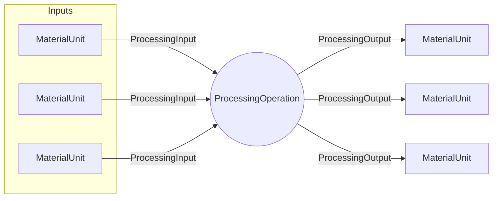
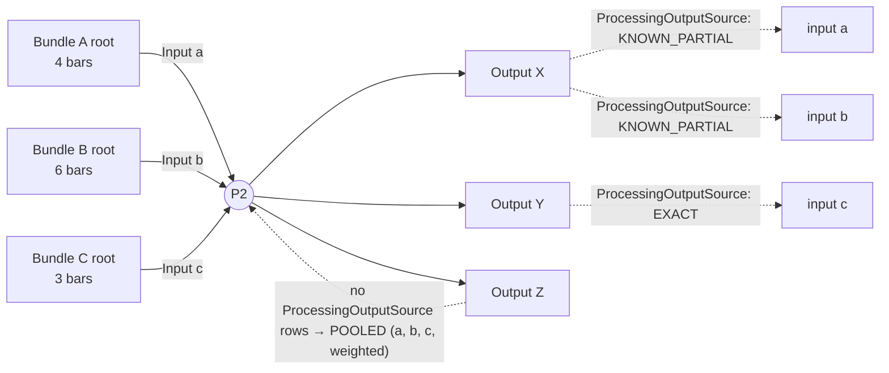

# SteelTrace — Conceptual Data Model

**Revision 4.** Still **[PROPOSED]** overall — a conceptual design, not yet implemented; no physical schema, migrations, or code exist. See `../CLAUDE.md` for the requirement provenance convention (distinguishing client-stated requirements from product/team decisions made in project discussions — see that file's legend).

**What changed in this revision**: Revision 3 (below) was a consistency pass before physical database design. Revision 4 adds seven operational concepts extracted directly from the client's own business documents — the Rebar Stock Management specification, the Inventory Control Excel template, and the structural BOQ/Rebar Schedule workbooks — rather than from working-session discussion. See §18–§24 (new) and the Revision 4 changelog at §25. Everything from Revision 3 below is carried forward unchanged except where §18–§24 note an extension (e.g., `MaterialUnit`/`Bundle` specification now also includes surface type, §19).

**What changed in Revision 3, and why (mapped to the review points that drove it):**
1. **Quantity ownership is now explicit about audit/atomicity**, not just "no duplication." A `MaterialUnit`'s `initial_*` quantity is immutable and distinct from its *derived* remaining quantity; every event that splits or consumes material is itself an attributed, timestamped, atomic record (§5).
2. **Pooled attribution is now three-tiered, not binary.** The old nullable `source_processing_input_id` on `ProcessingOutput` is replaced by a `ProcessingOutputSource` join table that can name an **exact** single source, a **known partial** subset of sources, or — only when nothing at all is recorded — fall back to a **pooled** attribution across *all* of the operation's inputs. An output no longer inherits bundles that didn't actually contribute to it just because the operation also used other bundles (§6).
3. **The status enum lost its one redundant value.** `SCRAPPED` duplicated `classification = SCRAP` and is removed; a validity matrix and event-transition table now make illegal combinations explicit (§7).
4. **Transfers get the same reconciliation discipline as processing operations** — dispatched vs. received quantity per line, a `reconciliation_status`, and discrepancies recorded, never silently dropped (§9).
5. **Material specification (diameter/grade/standard) is now a `MaterialUnit` attribute**, inherited and checked for consistency across an operation's inputs, so outputs can never end up spec-ambiguous (§10).
6. **Tenant isolation mechanics are spelled out in more operational detail** (§11), and the earlier "client architectural directive" phrasing is corrected — the shared-schema decision was a product/team decision made in this project's working sessions, not a verbatim client requirement; see `CLAUDE.md`.
7. **An entity catalog (§14) and four rewritten worked examples (§15)** confirm the revised mechanisms are mutually consistent.

## 1. Design Principles (revised)

1. **Tenancy is structural.** Every tenant-scoped row carries `company_id`; every relationship between two tenant-scoped rows must connect rows sharing the same `company_id` (§11).
2. **One generalized abstraction for "a trackable quantity of steel."** `MaterialUnit`, with an **immutable** `granularity` of `BUNDLE | BATCH | PIECE` (§3, §7).
3. **A row's initial quantity is immutable; its availability is derived, never overwritten.** See §5 — this is the precise mechanism behind "no duplicate inventory."
4. **All transformations and moves are attributed, timestamped, atomic events** that are edges in one genealogy graph — never an in-place mutation with no record of who/when (§5, §6).
5. **Never claim more precision than the recorded workflow supports — and never claim less than it does.** Exact attribution is preserved when the record supports it; partial-known attribution is preserved when that's all that's known; pooled attribution is the fallback only when nothing specific was recorded (§6).
6. **Conservation is checked on physical measure (length, and weight when available), never on piece count**, for both processing operations and transfers, and an unreconciled discrepancy is a visible, blocking condition (§8, §9).
7. **Material specification is physical, not bookkeeping** — diameter/grade/standard travel with the material and are checked for consistency wherever material is combined (§10).

## 2. Entity Overview

### 2.1 Tenancy & Identity
- **Company** — isolation root.
- **User** — belongs to one Company; has a `Role` (permission detail still open, `CLAUDE.md` §8 Q2).

### 2.2 Projects & Locations
- **Project** — belongs to one Company.
- **StorageLocation** — any place material can sit: warehouse, processing yard, construction site laydown area, etc., via `location_type` (`WAREHOUSE | PROCESSING_AREA | SITE | OTHER`).
- **LocationNode** / **LocationNodeType** — project-specific installation-location hierarchy (unchanged from revision 2).

### 2.3 Master Data
- **Supplier**, **Manufacturer**, **StructuralElementType**, **ReinforcementPurpose** — company-scoped, unchanged.

### 2.4 Physical Elements
- **StructuralElementInstance** — unchanged.

### 2.5 Bundles
- **Bundle**, **BundleAttributeDefinition**, **BundleAttributeValue** — unchanged in shape. QR encodes the Bundle, never a derived unit's state.
- **Bundle — revised attribute set (§18, §19, new)**: `origin_type` (`OPENING_STOCK | GRN_PURCHASE`, immutable); GRN/quality-verification fields (`grn_reference`, `po_reference`, `delivery_note_number`, `vehicle_info`, `weighbridge_ticket_number`, `mtc_reference`, `actual_weight_kg`) populated for `GRN_PURCHASE` bundles; `initial_disposition` (`ACCEPTED | ON_HOLD | DAMAGED_DISCREPANT`, default `ACCEPTED`) plus `approved_by_membership_id`/`approved_at` once reviewed; `surface_type` (`DEFORMED | PLAIN`, `NOT NULL`, default `DEFORMED`).

### 2.5a New Master Data — Rebar Catalog, Shape Codes (§20, §21, new)
- **RebarCatalogItem** — company-scoped: a standard rebar size (diameter × surface type) with its default grade/standard, standard bar length, default pieces per bundle, linear density, and reorder threshold.
- **ShapeCode** — company-scoped: a standard bent-bar profile (e.g. stirrup, L-bar) and which dimensions it uses.

### 2.6 Material Units
- **MaterialUnit** — revised attribute set:
  - `granularity`: `BUNDLE | BATCH | PIECE` — **set at creation, immutable for the row's lifetime.** Finer-grained tracking of part of a unit is always achieved by splitting off a new child row at the finer granularity, never by changing this value in place.
  - `classification`: `ORIGINAL | PENDING_RECONCILIATION | PREPARED | OFFCUT | SCRAP` (§7)
  - `status`: `AVAILABLE | RESERVED | CONSUMED | DISPATCHED | RECEIVED | INSTALLED | ON_HOLD` — **`SCRAPPED` removed** (§7); **`ON_HOLD` added in Revision 4** (§18) — a unit quarantined at intake or receipt, blocked from processing/reservation/installation until explicitly released.
  - `diameter`, `grade`, `standard` — **new**: the physical specification, inherited at creation time and immutable thereafter (§10)
  - `surface_type` (`DEFORMED | PLAIN`) — **new in Revision 4 (§19)**: inherited at creation, immutable, exactly like diameter/grade/standard.
  - `initial_quantity_pieces`, `initial_length`, `initial_weight` — **new framing**: set once at creation, never updated afterward. The unit's current available amount is **derived** (see §5), not a separate mutable column that could drift from or overwrite this original record.
  - `source_bundle_id` — set only on a Bundle-registration root unit.
  - `internal_reference_code` — **new in Revision 4 (§23)**, optional, human-readable (e.g. `ST-REM-0084` for a tagged reusable remnant).
  - `current_storage_location_id`, `company_id`, `project_id`.

### 2.7 Processing (Cutting & Bending)
- **ProcessingOperation** — Project, responsible User, timestamp, `reconciliation_status` (`UNRECONCILED | BALANCED | ADJUSTED`), and now implicitly a spec constraint across its inputs (§10).
- **ProcessingInput** — `(operation_id, material_unit_id, quantity_consumed_pieces, length_consumed, weight_consumed?)`. Many rows per operation, from any number of distinct `MaterialUnit`s/Bundles.
- **ProcessingOutput** — `(operation_id, material_unit_id, quantity_pieces, length, weight?)`. **No longer carries a direct source FK** — attribution moves to the new join table below.
- **ProcessingOutputSource** *(new)* — `(processing_output_id, processing_input_id, contribution_weight?, confidence: EXACT | KNOWN_PARTIAL)`. Zero, one, or several rows per output:
  - **Zero rows** ⇒ nothing specific was recorded ⇒ the output is attributed, at query time, to **all** of the operation's inputs, weighted by each input's share of total input length — reported with confidence `POOLED`. `POOLED` is never itself a stored value; it is the name for this fallback.
  - **One row with `confidence = EXACT`** ⇒ this output came entirely from that one input.
  - **One or more rows with `confidence = KNOWN_PARTIAL`** ⇒ the output is known to derive from exactly this named subset of the operation's inputs (which may be fewer than all of them) — not an arbitrary guess, and not inflated to include inputs that didn't actually contribute.
- **ConservationAdjustment** — **now polymorphic**: belongs to either a `ProcessingOperation` or a `MaterialTransfer` (conceptually a reference to "the reconciling event," physical representation TBD). `(event_type, event_id, measurement_basis: LENGTH | WEIGHT, amount, adjustment_type: TOLERANCE | CORRECTION, reason, recorded_by_user_id, recorded_at)`.

### 2.8 Intended vs. Actual Usage & Reclassification
- **IntendedUsageDeclaration**, **ReclassificationEvent** — unchanged in shape.

### 2.9 Material Transfer
- **MaterialTransfer** — `from_location_id`, `to_location_id`, `status` (`DISPATCHED | RECEIVED`), `dispatched_by_user_id`, `dispatched_at`, `vehicle_info?`, `received_by_user_id?`, `received_at?`, and **new**: `reconciliation_status` (`UNRECONCILED | BALANCED | ADJUSTED`), mirroring `ProcessingOperation` (§9).
- **MaterialTransferLine** — `(transfer_id, material_unit_id, dispatched_quantity_pieces, dispatched_length, received_quantity_pieces?, received_length?)`. Receipt fields are null until the receiving event. A **pure re-identification split with no actual relocation** (e.g., carving one physically-tagged bar out of an undifferentiated batch, with no location change) is modeled as a `MaterialTransfer` whose `from_location_id = to_location_id` — this keeps a single, uniform split mechanism instead of a parallel entity for "split without move" (§5).

### 2.10 Installation
- **Installation**, **InstallationLine** — unchanged from revision 2 (`InstallationLine` supports multiple source units per installation).

### 2.11 New Entities and Attribute Extensions (Revision 4)
- **BBSSchedule**, **BBSLine** — a Bar Bending Schedule and its lines (bar mark, spec, shape code and dimensions, cut length, bars required). §21.
- **ShapeCode** — company-scoped standard bent-bar profile. §2.5a, §21.
- **RebarCatalogItem** — company-scoped standard rebar size with linear density and reorder threshold. §2.5a, §20.
- **PhysicalStockCount**, **PhysicalStockCountLine** — a periodic physical count event and its per-unit system-vs-counted comparison. §22.
- **Attachment** — a supporting document (MTC, weighbridge ticket, delivery note, signed count sheet) linked to the record it evidences. §24.
- **ProcessingOperation** gains `reference_code` (human-readable, §23) and `checked_by_user_id`/`checked_at` (maker-checker, §24).
- **ReclassificationEvent** and **ConservationAdjustment** each gain `approved_by_user_id`/`approved_at` (maker-checker, §24).
- **ConservationAdjustment**'s polymorphic reference (§2.7) now has **three** possible targets, not two: a `ProcessingOperation`, a `MaterialTransfer`, or a `PhysicalStockCountLine` — exactly one is ever set (§22).
- **StorageLocation** gains an optional parent sub-location, plus `zone_code`/`rack_code`/`bay_code` (§23) — a storage sub-location hierarchy, distinct from `LocationNode`'s installation hierarchy.
- **Work order / reservation / intended-usage declaration → BBSLine**: each may optionally reference the `BBSLine` it fulfills (§21).

## 3. Material Identity — Six Concepts

*(Unchanged from revision 2; restated for completeness.)*

| Business concept | Representation |
|---|---|
| Supplier bundle | `Bundle` row + its root `MaterialUnit` (`BUNDLE`, `ORIGINAL`) |
| Original physical bar | Not a separate row by default — an undifferentiated share of a `BUNDLE`/`BATCH` unit's quantity, unless split off at `PIECE` granularity |
| Grouped material batch | `MaterialUnit` with `granularity=BATCH` |
| Prepared reinforcement | `MaterialUnit` with `classification=PREPARED` |
| Reusable offcut | `MaterialUnit` with `classification=OFFCUT` |
| Scrap | `MaterialUnit` with `classification=SCRAP` |

## 5. Quantity Ownership, Splitting, and Audit

*(§4 from revision 2, "parent/child genealogy," is superseded — its content is now split between §6, below, and §7's state machine.)*

This section makes the "no-duplication" rule from revision 2 precise enough to satisfy an auditor, addressing review point 1 directly.

**Immutable record, derived availability.** Every `MaterialUnit` stores its `initial_length`/`initial_quantity_pieces`/`initial_weight` exactly as recorded at creation — whether that creation was a Bundle registration or a `ProcessingOutput`/transfer-split. This value is **never updated**. What's "currently available" on that unit is **computed**, not stored:

```
available(unit) = initial(unit)
                   − Σ(ProcessingInput.quantity_consumed WHERE material_unit_id = unit)
                   − Σ(MaterialTransferLine.dispatched_quantity WHERE material_unit_id = unit
                                                                    AND it represents a split-off child)
```

Because `initial` never changes, the original recorded quantity is always traceable by reading the row itself — it cannot be silently overwritten by later activity. History is preserved as a side effect of this design, not as a bolted-on log: every `ProcessingInput` and `MaterialTransferLine` row is itself permanent and immutable (a correction is a new, compensating row, never an edit — consistent with the supersede pattern used elsewhere).

**Splitting is always an explicit, attributed event.** A child `MaterialUnit` comes into existence only via:
- a `ProcessingOutput` row (child was produced by a transformation), or
- a `MaterialTransferLine` row representing a partial-quantity move or a zero-distance re-identification split (child is identity-preserved, relocated and/or individually tagged, not transformed).

Both paths carry a responsible user and a timestamp (via the owning `ProcessingOperation` or `MaterialTransfer`), so **who recorded the split and when** is always answerable without extra bookkeeping.

**Atomicity.** The creation of a child `MaterialUnit` and the join row that references it (and thereby implicitly reduces the parent's derived availability) must be committed in one database transaction. The system must never persist a state where a child unit exists without the join row that accounts for where its quantity came from, or vice versa — otherwise `available()` would be computable to two different answers depending on timing. This is a correctness requirement carried into physical design (§13), not a convention trusted to application code alone.

**No duplicate inventory, worked against the client's example:**
1. `MaterialUnit U0`: `initial_length = 12 m`, `classification=ORIGINAL`. `available(U0) = 12 m`.
2. `ProcessingOperation P1` records `ProcessingInput(U0, length_consumed=12 m)` in the same transaction as its three outputs.
3. Outputs: `U1 (initial_length=9 m, PENDING_RECONCILIATION)`, `U2 (initial_length=2.5 m, PENDING_RECONCILIATION)`, `U3 (initial_length=0.5 m, PENDING_RECONCILIATION)`.
4. `available(U0)` is now computed as `12 − 12 = 0 m` — U0 is fully spoken for, so it can never again be referenced as an input elsewhere (enforced by the same constraint that keeps `available() ≥ 0`).
5. `available(U1) = 9`, `available(U2) = 2.5`, `available(U3) = 0.5`. Sum of all currently-available descendant quantities plus consumed quantities always equals `U0`'s original 12 m — at every point in time, not just at the end. No row anywhere claims more than its own `initial` amount, and no quantity is ever counted inside two rows' `available()` at once.
6. `U1/U2/U3` are later reclassified (`ReclassificationEvent`, §7) to `PREPARED`/`OFFCUT`/`SCRAP` respectively — classification changes don't touch quantity bookkeeping at all.

## 6. The Material Genealogy Graph & Attribution Precision

Genealogy remains a traversal of the bipartite graph introduced in revision 2 (`MaterialUnit` nodes, `ProcessingOperation`/`MaterialTransfer` event nodes, joined by `ProcessingInput`/`ProcessingOutput`/`MaterialTransferLine`). What's revised is **how an output's specific sources are recorded** (review point 2).

**Three attribution tiers, recorded per output:**
- **EXACT** — a single `ProcessingOutputSource` row naming the one input this output came from entirely.
- **KNOWN_PARTIAL** — one or more `ProcessingOutputSource` rows naming exactly which subset of the operation's inputs contributed, when that subset is known but the operation didn't (or couldn't) track exact proportions within it. Critically, **this subset can be smaller than the operation's full input set** — an output is never forced to inherit a bundle that is positively known not to have contributed to it.
- **POOLED** — no `ProcessingOutputSource` rows at all for that output. The fallback, used only when genuinely nothing specific is known: attribute to *every* input of the operation, weighted by each input's share of total input length.

**Backward genealogy query**: for a target `MaterialUnit`, find the `ProcessingOutput` row that created it (if any); look up its `ProcessingOutputSource` rows. If present, recurse into exactly those named `ProcessingInput`s' source units. If absent, recurse into *all* of the operation's `ProcessingInput`s (the `POOLED` fallback). At each step, also fold through any zero-or-partial `MaterialTransferLine` split edges (always 1:1 pass-through — a split never introduces new mixing, so it never changes attribution precision). Stop at units with `source_bundle_id` set. The result is a weighted set of root Bundles, each carrying the **weakest confidence tier encountered along its path** (`EXACT` only if every step was exact; a single `POOLED` step anywhere downgrades that whole path to `POOLED`, and a `KNOWN_PARTIAL` step downgrades it at least to `KNOWN_PARTIAL`).

**Forward genealogy query**: the mirror traversal — from a Bundle or unit, follow `ProcessingInput` forward into the operations it fed, then `ProcessingOutput`/`ProcessingOutputSource` forward into whatever those operations produced, recursively, until reaching `InstallationLine` references, `SCRAP`-terminal units, or units still `AVAILABLE`.

**`MaterialUnitOrigin`** (materialized cache, as in revision 2) now stores `(material_unit_id, bundle_id, contribution_weight, confidence: EXACT | KNOWN_PARTIAL | POOLED)` — the *computed result* of the above traversal, kept only for reporting performance; the graph traversal remains the source of truth.

## 7. The Material State Machine (revised)

**Three independent axes, now explicitly non-overlapping:**
- **Granularity** (identity): `BUNDLE | BATCH | PIECE` — set at creation, **immutable**.
- **Classification** (condition): `ORIGINAL | PENDING_RECONCILIATION | PREPARED | OFFCUT | SCRAP` — changes only via `ReclassificationEvent` (or is set once at creation).
- **Status** (lifecycle/location): `AVAILABLE | RESERVED | CONSUMED | DISPATCHED | RECEIVED | INSTALLED` — **`SCRAPPED` removed**, because it duplicated `classification=SCRAP`. A unit classified `SCRAP` simply stays wherever it physically is (typically `AVAILABLE` in a scrap area, or cycled through `DISPATCHED`/`RECEIVED` if hauled off-site) — the scrap bin doesn't need its own terminal lifecycle state; its classification already says everything needed for reporting.

**What causes each axis to change:**

| Event | Granularity | Classification | Status |
|---|---|---|---|
| Bundle registration | set (`BUNDLE`) | set (`ORIGINAL`) | set (`AVAILABLE`) |
| `ProcessingOutput` created | set on the new row (`BATCH`/`PIECE`, per what was recorded) | set on the new row (`PENDING_RECONCILIATION`) | set on the new row (`AVAILABLE`) |
| `ProcessingInput` recorded against an existing unit | unchanged | unchanged | → `CONSUMED` (that unit's `available()` reaches 0, or the consumed portion is split off first) |
| `MaterialTransferLine` split (partial, relocating) | set on new child (inherited, or finer if the split exists precisely to isolate a `PIECE`) | inherited unchanged | new child → `AVAILABLE` at destination once received |
| `MaterialTransfer` dispatched / received | unchanged | unchanged | → `DISPATCHED` → `RECEIVED` |
| `ReclassificationEvent` | unchanged | → `PREPARED`/`OFFCUT`/`SCRAP` (from `PENDING_RECONCILIATION`), or → `SCRAP` (from `OFFCUT`) | unchanged |
| `InstallationLine` recorded | unchanged | unchanged (typically `PREPARED`, or `ORIGINAL` for an unprocessed full-length bar used as-is) | → `INSTALLED` |
| Reservation (linked to an `IntendedUsageDeclaration`) | unchanged | unchanged | → `RESERVED` |

**Invalid combinations (checked at write time, not just by convention):**
- `granularity=BUNDLE` with `classification` other than `ORIGINAL` — a bundle-level row represents as-received, unprocessed material by definition; anything processed must live on a `BATCH`/`PIECE` child row.
- `classification=SCRAP` with `status ∈ {CONSUMED, INSTALLED}` — scrap can be relocated (`DISPATCHED`/`RECEIVED`) but never consumed as a `ProcessingInput` or installed.
- `classification=PENDING_RECONCILIATION` with `status ∈ {CONSUMED, INSTALLED}` — material must be reclassified out of "awaiting reconciliation" before it can be used or installed; it **may** still be transferred (`DISPATCHED`/`RECEIVED`) while pending, since relocation and classification are independent.
- `status=INSTALLED` for any unit whose `available()` was already fully consumed elsewhere, or that is already `INSTALLED` on a different active `InstallationLine` — a unit is installed at most once (a correction supersedes the prior `InstallationLine`, it doesn't add a second live one for the same quantity).

## 8. Conservation and Reconciliation (unchanged basis, restated)

Unchanged from revision 2: the invariant is evaluated on length (and weight when actual weights exist), never on piece count, via `ProcessingOperation.reconciliation_status`. See `CLAUDE.md` §2.5 for the business statement and §13 below for what's still open (tolerance thresholds, mandatory weight reconciliation).

## 9. Transportation & Material Transfer — Reconciled Like Processing (revised)

`MaterialTransfer` already covers every location pair the client specified (warehouse↔warehouse, warehouse↔processing area, →site, processing area→site) via `StorageLocation.location_type` generalization (unchanged from revision 2). This revision adds the same reconciliation discipline processing operations have, addressing review point 4:

- Each `MaterialTransferLine` records `dispatched_quantity` at dispatch time and `received_quantity` at receipt time — **separately**, not as one mutable field. A full, matching receipt is the common case; a **partial receipt** (`received_quantity < dispatched_quantity` — loss, damage, miscount in transit) is recorded as-is, never force-matched.
- `MaterialTransfer.reconciliation_status` starts `UNRECONCILED` and becomes `BALANCED` (received = dispatched, for every line) or `ADJUSTED` (a `ConservationAdjustment` row explains the gap — e.g., `adjustment_type=CORRECTION`, reason "transit damage, discarded on arrival"). A transfer sitting `UNRECONCILED` is a visible, queryable flag — exactly the "never let a discrepancy silently disappear" rule applied to movement, not just processing.
- **No new material, no inventory inflation**: the receiving side never shows more than what was actually confirmed received. If a line's `received_quantity` is less than dispatched, the destination `MaterialUnit`'s `initial_length`/`initial_quantity_pieces` is set to the **received** amount, not the dispatched amount — the shortfall is accounted for by the `ConservationAdjustment`/discrepancy record, not materialized as phantom destination inventory. The source side's `available()` was already decremented by the full dispatched amount at dispatch time (§5), so the missing quantity is accounted for exactly once, at the point it was recorded as lost — never doubly subtracted or doubly ignored.
- A transfer reaching `RECEIVED` only ever sets `status=RECEIVED` — it never sets `status=INSTALLED` and never touches `classification` (§7).

## 10. Material Specification Preservation & Compatibility (new)

Review point 5. Diameter, grade, manufacturing standard, and (Revision 4) **surface type** are **physical properties of the steel**, not bookkeeping artifacts, so they're modeled as attributes directly on `MaterialUnit` (§2.6), not something that must be re-derived by walking the genealogy graph every time.

- A Bundle-root `MaterialUnit` inherits `diameter`/`grade`/`standard`/`surface_type` directly from its `Bundle`.
- **[PROPOSED] Input compatibility rule**: every `ProcessingInput` row attached to the same `ProcessingOperation` must reference `MaterialUnit`s with **identical** `diameter`, `grade`, `standard`, and `surface_type`. This is proposed as a data-integrity check, not merely a convention, because combining physically different rebar into one operation makes the operation's output spec undefined — there is no real-world equivalent of "9 m of partially-12mm-partially-16mm reinforcement," and a deformed bar and a plain bar of the same diameter are still two different products (§19). Every `ProcessingOutput` of that operation then simply **inherits the one shared spec** of its inputs directly (copied at creation, immutable) — there is no scenario, under this rule, where an output's spec is ambiguous or mixed.
- **This rule is now confirmed, not merely proposed, against real client workflows** (`CLAUDE.md` §8 Q11): the one apparent counter-example — a precast beam cage combining plain and deformed bars of different diameters — is not actually a mixed-spec processing operation; it is one `StructuralElementInstance` fed by several single-spec `InstallationLine`s (§21). The compatibility rule itself therefore needs no exception; only its *scope of comparison* grew (diameter/grade/standard **and now surface_type**).
- A `MaterialTransfer` never changes spec (it only relocates), so no compatibility check is needed there — the receiving side's `MaterialUnit` simply carries forward whatever spec it already had.

## 11. Multi-Company Architecture: Logical Isolation, Shared Schema (expanded)

One application, one shared schema, no per-company tables — this was established as a product/team decision during project discussions (`CLAUDE.md` §2.1), not a specific instruction the end client gave. The mechanics:

- **Which records are company-scoped**: every entity in this model, with no exceptions — there is currently no shared/global table (reference catalogs like diameters or grades, if ever made cross-company, would be the one deliberate exception, and that remains an open question, `CLAUDE.md` §8 Q1).
- **How ownership is enforced in relationships [PROPOSED]**: every foreign-key relationship between two tenant-scoped rows must connect rows that resolve to the same `company_id`. Concretely: a `ProcessingInput`'s `MaterialUnit` and the `ProcessingOperation` it belongs to must share one `company_id`; a `MaterialTransfer`'s `from_location`/`to_location` must both belong to the transfer's own company; an `InstallationLine`'s `MaterialUnit`, `StructuralElementInstance`, and `ReinforcementPurpose` must all agree. This is checked at write time (constraint/trigger — physical mechanism deferred to §13), not assumed from application code alone.
- **How cross-company references are prevented**: by construction, given the rule above — there is no code path that can create a row whose relationships span two different `company_id` values, because the write is rejected before it commits.
- **RLS and application authorization, together**: Postgres row-level security (or equivalent), scoped to a session-bound company context, answers *"can this session see or touch company X's rows at all"* — the tenant boundary, enforced even if a query is missing an explicit filter. Application-level authorization answers a different question — *"within their own company's data, is this specific user/role allowed to perform this specific action"* (e.g., can a warehouse worker record an installation) — the permission boundary, tied to the still-open role/permission design (`CLAUDE.md` §8 Q2). Neither substitutes for the other: RLS without application authorization would let any authenticated user of a company do anything within it; application authorization without RLS would rely entirely on every query remembering to filter by company, with no backstop if one doesn't.

## 12. Entity-Relationship Diagram (revised)

```mermaid
erDiagram
    COMPANY ||--o{ USER : employs
    COMPANY ||--o{ PROJECT : owns
    COMPANY ||--o{ SUPPLIER : defines
    COMPANY ||--o{ MANUFACTURER : defines
    COMPANY ||--o{ STRUCTURAL_ELEMENT_TYPE : defines
    COMPANY ||--o{ REINFORCEMENT_PURPOSE : defines
    COMPANY ||--o{ STORAGE_LOCATION : owns
    COMPANY ||--o{ BUNDLE : owns

    PROJECT ||--o{ LOCATION_NODE : "has hierarchy of"
    LOCATION_NODE ||--o{ LOCATION_NODE : "parent of"
    PROJECT ||--o{ STRUCTURAL_ELEMENT_INSTANCE : contains
    STRUCTURAL_ELEMENT_TYPE ||--o{ STRUCTURAL_ELEMENT_INSTANCE : "is type of"
    LOCATION_NODE ||--o{ STRUCTURAL_ELEMENT_INSTANCE : "located at"

    SUPPLIER ||--o{ BUNDLE : supplies
    MANUFACTURER ||--o{ BUNDLE : produces
    BUNDLE ||--|| MATERIAL_UNIT : "creates root"
    BUNDLE ||--o{ MATERIAL_UNIT_ORIGIN : "is origin via"
    MATERIAL_UNIT ||--o{ MATERIAL_UNIT_ORIGIN : "traces to (cached)"
    STORAGE_LOCATION ||--o{ MATERIAL_UNIT : holds

    MATERIAL_UNIT ||--o{ PROCESSING_INPUT : "feeds (many)"
    PROCESSING_OPERATION ||--o{ PROCESSING_INPUT : consumes
    PROCESSING_OPERATION ||--o{ PROCESSING_OUTPUT : produces
    PROCESSING_OUTPUT }o--|| MATERIAL_UNIT : creates
    PROCESSING_OUTPUT ||--o{ PROCESSING_OUTPUT_SOURCE : "attributed by (0..n)"
    PROCESSING_OUTPUT_SOURCE }o--|| PROCESSING_INPUT : names
    PROCESSING_OPERATION ||--o{ CONSERVATION_ADJUSTMENT : "may record"
    PROCESSING_OPERATION ||--o| INTENDED_USAGE_DECLARATION : "declared before"

    MATERIAL_UNIT ||--o{ RECLASSIFICATION_EVENT : "reclassified by"

    MATERIAL_TRANSFER ||--o{ MATERIAL_TRANSFER_LINE : includes
    MATERIAL_TRANSFER_LINE }o--|| MATERIAL_UNIT : "moves / splits"
    MATERIAL_TRANSFER ||--o{ CONSERVATION_ADJUSTMENT : "may record"
    STORAGE_LOCATION ||--o{ MATERIAL_TRANSFER : "from/to"

    INSTALLATION ||--o{ INSTALLATION_LINE : includes
    INSTALLATION_LINE }o--|| MATERIAL_UNIT : consumes
    INSTALLATION_LINE }o--|| STRUCTURAL_ELEMENT_INSTANCE : "installed into"
    INSTALLATION_LINE }o--|| REINFORCEMENT_PURPOSE : fulfills
    INSTALLATION ||--o| INSTALLATION : supersedes

    USER ||--o{ PROCESSING_OPERATION : performs
    USER ||--o{ MATERIAL_TRANSFER : "dispatches/receives"
    USER ||--o{ INSTALLATION : installs
    USER ||--o{ RECLASSIFICATION_EVENT : performs

    COMPANY ||--o{ REBAR_CATALOG_ITEM : defines
    COMPANY ||--o{ SHAPE_CODE : defines
    PROJECT ||--o{ BBS_SCHEDULE : "takeoff for"
    BBS_SCHEDULE ||--o{ BBS_LINE : includes
    SHAPE_CODE ||--o{ BBS_LINE : "bent per"
    BBS_LINE ||--o| WORK_ORDER : "optionally fulfilled by"
    BBS_LINE ||--o| MATERIAL_RESERVATION : "optionally fulfilled by"
    BBS_LINE ||--o| INTENDED_USAGE_DECLARATION : "optionally fulfilled by"

    STORAGE_LOCATION ||--o{ PHYSICAL_STOCK_COUNT : "counted at"
    PHYSICAL_STOCK_COUNT ||--o{ PHYSICAL_STOCK_COUNT_LINE : includes
    PHYSICAL_STOCK_COUNT_LINE }o--|| MATERIAL_UNIT : counts
    PHYSICAL_STOCK_COUNT_LINE ||--o{ CONSERVATION_ADJUSTMENT : "may record"

    COMPANY ||--o{ ATTACHMENT : stores
```



## 13. Genealogy Graph Diagrams (revised attribution)

**General bipartite pattern**, unchanged in shape:



**Worked example: three bundles, mixed attribution (revised Example B — see §15):**



`OX` traces to `{A, B}` only — `C` is correctly excluded even though it fed the same operation. `OY` traces exactly to `{C}`. `OZ` has nothing specific recorded, so it falls back to `{A, B, C}` weighted by each bundle's share of the 13-bar total (4/13, 6/13, 3/13) — reported as `POOLED`.

## 14. Entity Catalog — Purpose and Relationships

| Entity | Purpose | Key relationships |
|---|---|---|
| **Company** | Tenant isolation root | Parent of every other entity, directly or transitively |
| **User** | Who performs actions | Belongs to Company; referenced by every event entity as the responsible actor |
| **Project** | A construction job | Belongs to Company; scopes LocationNode, StructuralElementInstance, and (optionally) MaterialUnits |
| **StorageLocation** | Any physical place material sits | Belongs to Company; endpoints of MaterialTransfer; current location of MaterialUnit |
| **LocationNode** | Node in a project's installation-location hierarchy | Self-referencing tree under Project; located-at target of StructuralElementInstance |
| **Supplier / Manufacturer** | Who sold / who made the steel | Referenced by Bundle |
| **StructuralElementType / ReinforcementPurpose** | Configurable classification of installation purpose | Independent of each other; referenced by StructuralElementInstance / InstallationLine respectively |
| **StructuralElementInstance** | One real element in a project (e.g. "Column C-12") | References StructuralElementType and LocationNode; target of InstallationLine |
| **Bundle** | As-received supplier unit, source of truth for label data | Creates exactly one root MaterialUnit; QR target |
| **MaterialUnit** | The generalized trackable quantity (genealogy graph's "material" node) | Created by Bundle registration, ProcessingOutput, or MaterialTransferLine split; referenced by ProcessingInput, MaterialTransferLine, InstallationLine, ReclassificationEvent |
| **MaterialUnitOrigin** | Cached backward-genealogy result | Derived from the ProcessingOutputSource/ProcessingInput/ProcessingOutput graph; references Bundle and MaterialUnit |
| **ProcessingOperation** | One cutting/bending event (genealogy graph's "event" node) | Has many ProcessingInput and ProcessingOutput rows; may have ConservationAdjustment and an IntendedUsageDeclaration |
| **ProcessingInput** | "This operation consumed this much of this unit" | Links ProcessingOperation ↔ MaterialUnit |
| **ProcessingOutput** | "This operation produced this new unit" | Links ProcessingOperation → new MaterialUnit; attributed via ProcessingOutputSource |
| **ProcessingOutputSource** | Named source attribution for one output, at EXACT or KNOWN_PARTIAL precision | Links ProcessingOutput ↔ ProcessingInput |
| **ConservationAdjustment** | Documented, attributed explanation for an input/output length or weight mismatch | References a ProcessingOperation or a MaterialTransfer |
| **IntendedUsageDeclaration** | Pre-processing declared intent | Linked to a ProcessingOperation; superseded chain for corrections |
| **ReclassificationEvent** | Explicit, attributed change of a unit's classification | References the MaterialUnit and the responsible User |
| **MaterialTransfer** | One location-to-location movement (genealogy graph's other "event" node) | Has many MaterialTransferLine rows; references two StorageLocations; may have ConservationAdjustment |
| **MaterialTransferLine** | "This much of this unit moved from A to B" (whole-unit move, partial split, or zero-distance re-identification split) | Links MaterialTransfer ↔ MaterialUnit (and, for a split, ↔ the new child MaterialUnit) |
| **Installation** | One installation event, possibly multi-source | Has many InstallationLine rows |
| **InstallationLine** | "This much of this unit was installed into this element for this purpose" | Links Installation ↔ MaterialUnit ↔ StructuralElementInstance ↔ ReinforcementPurpose |
| **RebarCatalogItem** *(new, §20)* | Company-scoped standard rebar size: default spec, standard length, linear density, reorder threshold | Referenced for theoretical-weight calculations; independent of any single Bundle |
| **ShapeCode** *(new, §21)* | Company-scoped standard bent-bar profile and its dimension set | Referenced by BBSLine |
| **BBSSchedule** *(new, §21)* | One Bar Bending Schedule (engineering takeoff document) | Belongs to Project; has many BBSLine rows |
| **BBSLine** *(new, §21)* | One takeoff line: spec, shape, dimensions, cut length, bars required | References ShapeCode, StructuralElementType/Instance, LocationNode, ReinforcementPurpose; optionally referenced by WorkOrder/MaterialReservation/IntendedUsageDeclaration |
| **PhysicalStockCount** *(new, §22)* | One physical count event at a storage location | Has many PhysicalStockCountLine rows |
| **PhysicalStockCountLine** *(new, §22)* | "This unit's system quantity vs. what was physically counted" | Links PhysicalStockCount ↔ MaterialUnit; may have a ConservationAdjustment |
| **Attachment** *(new, §24)* | One supporting document (MTC, weighbridge ticket, delivery note, signed count sheet) | References whichever record it evidences (Bundle, PhysicalStockCount, etc.) by table + record id |

## 15. Worked Examples (revised)

### Example A — One bar split into column reinforcement and a reusable beam offcut
1. Bundle A registered → root `MaterialUnit U0` (`BUNDLE`, 50 bars × 12 m, `ORIGINAL`, `AVAILABLE`, `diameter=16mm, grade=B500B`). `available(U0, before)` = 50 bars / 600 m.
2. `ProcessingOperation P1`: `ProcessingInput(U0, 1 bar, 12 m)`, recorded atomically with its outputs. `available(U0)` → 49 bars / 588 m.
3. Outputs (all inherit `diameter=16mm, grade=B500B` from `P1`'s single input, §10): `U1` (9 m, `PENDING_RECONCILIATION`), `U2` (2.5 m, `PENDING_RECONCILIATION`), `U3` (0.5 m, `PENDING_RECONCILIATION`). Sum = 12 m = input; `P1.reconciliation_status = BALANCED`.
4. `ReclassificationEvent`s: `U1→PREPARED` (column), `U2→OFFCUT` (candidate for beam reuse), `U3→SCRAP`.
5. Backward genealogy of `U1`: no `ProcessingOutputSource` rows needed (only one input existed) → trivially `{Bundle A}`, confidence `EXACT`.

### Example B — Multiple bundles combined, mixed attribution (revised per review point 2)
1. Bundles A (4 bars), B (6 bars), C (3 bars) already registered, same diameter/grade (required by §10's compatibility rule).
2. `ProcessingOperation P2`: `ProcessingInput` rows `a=(U_A,4 bars)`, `b=(U_B,6 bars)`, `c=(U_C,3 bars)` — 13 bars total.
3. Three outputs recorded with different knowledge levels:
   - `OutputX`: `ProcessingOutputSource(OutputX, a, KNOWN_PARTIAL)`, `ProcessingOutputSource(OutputX, b, KNOWN_PARTIAL)` — workers know it's an A/B mix, not exact proportions, and know **C did not contribute**.
   - `OutputY`: `ProcessingOutputSource(OutputY, c, EXACT)` — this piece is known to be entirely from Bundle C.
   - `OutputZ`: no `ProcessingOutputSource` rows at all — nothing specific was tracked.
4. Backward genealogy: `OutputX → {A, B}` (`KNOWN_PARTIAL`, **C correctly excluded**); `OutputY → {C}` (`EXACT`); `OutputZ → {A, B, C}` weighted 4/13, 6/13, 3/13 (`POOLED`, the fallback, used only because nothing was recorded for it).

### Example C — Reusable offcuts processed repeatedly
1. `U2` (2.5 m `OFFCUT` from Example A) sits `AVAILABLE`.
2. `ProcessingOperation P3`: `ProcessingInput(U2, 2.5 m)`. Outputs: `U4` (2.2 m → `PREPARED`, beam), `U5` (0.3 m → `SCRAP`). Both inherit `U2`'s spec (16mm/B500B) per §10 — trivially consistent since `P3` has only one input.
3. Backward genealogy of `U4`: `U4 ← P3 ← U2 ← P1 ← U0 ← Bundle A` — two hops, no attribution ambiguity since every step had exactly one input. Demonstrates repeated reuse needs no special-casing of the graph mechanics.

### Example D — One installation receiving material from multiple bundles
1. Column C-12's main reinforcement installation draws three previously prepared units: `U1` (Example A, traces `EXACT` to Bundle A), `OutputX` (Example B, traces `KNOWN_PARTIAL` to `{A,B}`), and `U7` (an independent operation on Bundle D, traces `EXACT` to Bundle D).
2. One `Installation` for Column C-12 / main reinforcement has three `InstallationLine` rows, one per source unit, each with its own quantity and `status→INSTALLED` applied to each referenced unit individually.
3. Backward genealogy of the whole Installation = the union of each line's origin: `{Bundle A (EXACT, line 1), Bundle A & B (KNOWN_PARTIAL, line 2), Bundle D (EXACT, line 3)}` — reported per line and in aggregate, each tagged with its own confidence, never flattened into a single misleadingly-precise or misleadingly-vague claim.

## 16. What This Model Still Deliberately Defers

- Permission matrix per role (`CLAUDE.md` §8 Q2).
- Cross-project material transfer business rule (`CLAUDE.md` §8 Q10).
- Physical schema: concrete types, indexing, the exact mechanism enforcing the relationship-level tenant rule (§11), the `available()` computation (materialized/cached vs. computed on read), and the input-compatibility and conservation checks (trigger vs. constraint vs. transactional application check).
- Reporting schema (`CLAUDE.md` §2.12).
- Whether `ConservationAdjustment`'s polymorphic reference to "a ProcessingOperation or a MaterialTransfer" is modeled as two nullable FKs, a single polymorphic reference, or two separate tables sharing a conceptual role — a physical-schema decision.

## 17. Open Items From This Revision (to fold into `CLAUDE.md` §8)

1. **Input compatibility rule, now with a proposed default** — **largely confirmed in Revision 4**: §10 proposes that a single processing operation's inputs must share identical diameter/grade/standard/surface_type. The client's BOQ/Rebar Schedule workbooks confirm the one apparent counter-example (a mixed-spec precast cage) is handled without combining specs in one operation (§21). Still open: whether any other, undocumented workflow needs a genuine mixed-spec operation.
2. **Tolerance auto-acceptance** (carried over from revision 2, now applying to transfers too): is there a length/weight discrepancy threshold small enough to auto-accept without a human-recorded adjustment, for either a processing operation or a transfer?
3. **Weight reconciliation obligation** (carried over): ever mandatory, or always best-effort?
4. **Partial-receipt resolution authority**: who is authorized to close out a transfer's discrepancy (§9) — does it require approval, or just attribution/reason at time of entry? (Same question as the processing-side adjustment workflow, `CLAUDE.md` §8 Q7, now posed for transfers.)
5. **EXACT/KNOWN_PARTIAL recording — whose effort?**: is recording per-output source attribution (§6) an expected part of a worker's normal data entry, an optional extra step taken only when it's easy, or something a supervisor adds after the fact? This affects how often real operations will actually end up `POOLED` vs. more precisely attributed in practice.

## 18. Goods Receipt, Opening Stock, and Intake Quarantine **[CLIENT REQUIREMENT]**

Extracted from the client's Rebar Stock Management specification and Inventory Control Excel template (`CLAUDE.md` §2.13).

- **Bundle origin**: every `Bundle` carries an immutable `origin_type` — `OPENING_STOCK` (the one-time starting inventory, 102 bundles/~204 MT, recorded once at system launch) or `GRN_PURCHASE` (every subsequent delivery, received via a formal Goods Receipt Note). This is a fact about how the material entered the system, never changed afterward.
- **GRN/quality-verification data**, populated on `GRN_PURCHASE` bundles: a GRN reference, PO reference, delivery note number, vehicle info, weighbridge ticket number, MTC reference, and the weighbridge-measured **actual weight** — distinct from the *theoretical* weight derived from the rebar catalog (§20). The gap between the two is the bundle's **rolling margin** (§20), a quality/quantity signal, never hidden or silently corrected away.
- **Intake disposition and quarantine**: every `Bundle` carries `initial_disposition` (`ACCEPTED | ON_HOLD | DAMAGED_DISCREPANT`, default `ACCEPTED`) plus, once reviewed, `approved_by`/`approved_at`. This reuses the identical disposition vocabulary already defined for `MaterialTransfer` receipts (§9) — the same concept now also gates material entering the system for the first time, not only material moving between locations.
- **Effect on the root `MaterialUnit`**: bundle registration (§2.2, §5) still creates exactly one root `MaterialUnit`, but its starting `status` now depends on `initial_disposition` — `ACCEPTED` starts `AVAILABLE` as before; `ON_HOLD` or `DAMAGED_DISCREPANT` starts **`ON_HOLD`** (quarantined). A quarantined unit cannot be referenced by a `ProcessingInput`, a `MaterialReservation`, or an `InstallationLine` (the same restriction already enforced for a received-but-held transfer portion, §9/§11) until released.
- **Release**: a `MaterialHoldRelease` event (unchanged entity, now also reachable from a quarantined bundle-root unit, not only a quarantined transfer-receipt portion) moves the unit `ON_HOLD → AVAILABLE`, attributed and timestamped. If the material is genuinely unusable, an ordinary `ReclassificationEvent` then moves it toward `SCRAP` — no new state-transition mechanism is needed, only a new *reason* a unit can start life `ON_HOLD`.
- See `docs/physical-database-design.md` §4 (bundle columns, `bundle_origin_type_enum`), §12 (`register_bundle` function).

## 19. Surface Type and Expanded Specification Compatibility **[CLIENT REQUIREMENT]**

Extracted from the client's structural BOQ/Rebar Schedule workbooks (`CLAUDE.md` §2.14).

- The client's projects use both **deformed** (ribbed, 8–28 mm) and **plain** (smooth, 6 mm — precast stirrups/links, ribbed-slab mesh) bars. `surface_type` (`DEFORMED | PLAIN`, default `DEFORMED`) joins diameter/grade/standard as a physical specification attribute: present on `Bundle`, inherited immutably onto the root `MaterialUnit` at registration, and carried forward unchanged through every split/output exactly like the other spec fields (§10).
- **§10's `spec_compare` function is extended, not replaced**: two units are compatible only if diameter, grade, standard, **and surface type** all agree (or, for `standard`, are both unknown — §8 of the physical design keeps its existing three-valued treatment for that one field; `surface_type`, like `diameter`/`grade`, is always known and so is always definitively comparable). A 12 mm deformed bar and a 12 mm plain bar of the same grade are still `CONFIRMED_INCOMPATIBLE` — they are different products, not a matching pair that happens to differ on a cosmetic attribute.
- This extension changes *what* is compared, not *how* — the three-valued outcome (`CONFIRMED_MATCH`/`CONFIRMED_INCOMPATIBLE`/`UNKNOWN`) and its use in operation input-uniformity, `POOLED` candidate-set membership, and output-spec inheritance (§10) are unchanged in mechanism.
- See `docs/physical-database-design.md` §1a (`rebar_surface_type_enum`), §4, §8.

## 20. Rebar Catalog and Theoretical Weight **[CLIENT REQUIREMENT + PROPOSED]**

Extracted from the client's Inventory Control Excel template and BOQ workbooks (`CLAUDE.md` §2.15).

- **RebarCatalogItem** (new, company-scoped master data, §2.5a): one row per standard rebar size (diameter × surface type), carrying a default grade/standard, a standard bar length, a default pieces-per-bundle figure, a **linear density** (kg/m), and a reorder threshold (metric tons). That such a catalog is needed is a client-documented fact **[CLIENT REQUIREMENT]**; modeling it as its own master-data table rather than inline constants is this project's design choice **[PROPOSED]**.
- **Linear density source**: a company may populate it from the theoretical formula (`diameter_mm² / 162`, kg/m) or from a standard engineering lookup table (which differs slightly from the formula at some diameters) — both are legitimate, and the choice is per company, not system-imposed.
- **Two derived figures, computed, never separately stored** (consistent with the "no competing quantity column" principle, §5):
  - `theoretical_weight_kg(unit) = total_length_m(unit) × linear_density_kg_per_m` (from the unit's own spec match in the catalog).
  - `rolling_margin_kg(bundle) = actual_weight_kg(bundle) − (piece_count × bar_length_m × linear_density_kg_per_m)` — how far a GRN bundle's weighbridge-measured weight diverges from what its catalog-predicted theoretical weight would be.
- Neither figure is authoritative inventory data — they are reporting/QA signals computed from the catalog and the bundle's own recorded facts, never used to override `total_length_m`/`total_weight_kg` on a `MaterialUnit`.
- See `docs/physical-database-design.md` §3a (`rebar_catalog_items`), §14.

## 21. Bar Bending Schedules, Shape Codes, and Takeoff Linkage **[CLIENT REQUIREMENT]**

Extracted from the client's structural BOQ/Rebar Schedule workbooks (`CLAUDE.md` §2.16).

- **ShapeCode** (new, company-scoped master data): a standard bent-bar profile (e.g. a stirrup, an L-bar) and the set of dimensions it uses (not every shape uses every dimension slot) — configurable per company, never hardcoded, consistent with the existing rule for structural element types/reinforcement purposes (§2.6).
- **BBSSchedule** (new): one Bar Bending Schedule — an engineering takeoff document for a Project, with a reference/drawing identity (reference code, drawing number/revision), a wastage allowance percentage, a preparer, and a maker-checker approval (§24).
- **BBSLine** (new): one takeoff line within a schedule — the structural element type/instance, location, reinforcement purpose, bar mark, spec (diameter/surface type/grade), shape code and its dimension values, cut length, and how many bars are required per member and in total.
- **Optional fulfillment linkage**: `WorkOrder`, `MaterialReservation`, and `IntendedUsageDeclaration` may each **optionally** reference the `BBSLine` they fulfill — optional because not every real operation originates from a formal takeoff line, but when one does, the system can trace actual processing/reservation activity back to the engineering document that called for it.
- **Multi-spec members, resolved without weakening §10's single-spec-per-operation rule**: a structural member combining multiple specs in one physical assembly — e.g. a precast beam cage with 6 mm plain stirrups and 12 mm/14 mm deformed main bars (the client's BOQ shows cage types like PB1, PB2) — is modeled as **one `StructuralElementInstance` receiving several single-spec `InstallationLine` rows**, one per spec. `ProcessingOperation` itself stays strictly single-spec; the multi-spec reality lives at the installation level, where it already belonged conceptually (§2.11's "one installation may draw from more than one bundle" already established that an installation, unlike an operation, is the right place for multiplicity). This resolves `CLAUDE.md` §8 Q11's open question.
- See `docs/physical-database-design.md` §3a (`shape_codes`), §9a (`bbs_schedules`, `bbs_lines`), composite `bbs_line_id` FKs on `work_orders`/`material_reservations`/`intended_usage_declarations`.

## 22. Physical Stock Count and Variance Reconciliation **[CLIENT REQUIREMENT]**

Extracted from the client's Inventory Control Excel template (`CLAUDE.md` §2.17).

- **PhysicalStockCount** (new): one counting event at a `StorageLocation` — a reference code, count date, status, a counting actor, a verifying actor/timestamp, and notes.
- **PhysicalStockCountLine** (new): one counted `MaterialUnit` within that count — the system's recorded piece count/length at count time, the physically counted piece count/length, the resulting length variance, and investigation notes.
- **This is a third kind of reconciling event**, alongside `ProcessingOperation` and `MaterialTransfer` (§8, §9): `ConservationAdjustment`'s polymorphic reference (§2.7) now has **three** possible targets instead of two — a `ProcessingOperation`, a `MaterialTransferLine`, or a `PhysicalStockCountLine` — with the same rule as before: **exactly one** is ever set on a given adjustment row, never zero, never more than one.
- The same "never let a discrepancy silently disappear" discipline applies: a counted variance is recorded and, where confirmed as a real loss/gain rather than a measurement artifact, becomes a `ConservationAdjustment` against the count line — it never silently overwrites the unit's own immutable `initial_*` figures (§5), consistent with every other reconciling event in this model.
- See `docs/physical-database-design.md` §9b (`physical_stock_counts`, `physical_stock_count_lines`), §9 (`conservation_adjustments`'s extended CHECK constraint), §14 (`remaining()` extended to account for approved count adjustments).

## 23. Human-Readable Reference Codes and Storage Sub-Locations **[CLIENT REQUIREMENT]**

Extracted from the client's Rebar Stock Management specification and Inventory Control Excel template (`CLAUDE.md` §2.18).

- **Reference codes**: `ProcessingOperation` gains a required, company-unique human-readable `reference_code` (e.g. `ST-PROC-0021`); `MaterialUnit` gains an *optional* company-unique `internal_reference_code` (e.g. `ST-REM-0084`), used for tagged reusable remnants/batches that staff refer to by name. Both sit alongside, never instead of, the entity's internal `id` — the internal id remains the join-key and QR target; the reference code is the human-facing label (and, for a tagged remnant, may itself be what a printed QR encodes/displays).
- **Storage sub-locations**: `StorageLocation` gains an optional parent `StorageLocation`, plus `zone_code`/`rack_code`/`bay_code` — letting a bay sit inside a rack inside a zone inside a warehouse. This is a **physical storage hierarchy** — where inventory sits before it is used — and must not be confused with `LocationNode` (§2.2), which is the project-specific **installation** location hierarchy (where steel ends up in the building). The two hierarchies are independent and serve different questions.
- See `docs/physical-database-design.md` §3 (`storage_locations` sub-location columns), §9 (`processing_operations.reference_code`), §4 (`material_units.internal_reference_code`).

## 24. Maker-Checker Approval and Document Attachments **[CLIENT REQUIREMENT]**

Extracted from the client's Rebar Stock Management specification (`CLAUDE.md` §2.19).

- **Maker-checker**: the client's processes for goods receipt, cutting/bending, and physical stock counts have one person record the entry and a second, distinct person review/approve it. `ProcessingOperation` gains `checked_by`/`checked_at`; `ReclassificationEvent` and `ConservationAdjustment` each gain `approved_by`/`approved_at` — a second, independent attribution alongside the existing "who recorded this" attribution (§5, §2.7), never replacing it. (`Bundle.approved_by`/`approved_at`, §18, and `PhysicalStockCount.verified_by`/`verified_at`, §22, are the same pattern applied where those entities already needed it.)
- **This confirms a pattern for these specific record types**; it is not a complete role/permission matrix (`CLAUDE.md` §8 Q2 remains otherwise open — *which* role may act as checker is unresolved, `CLAUDE.md` §8 item 21).
- **Attachment** (new): a tenant-scoped, generic "supporting document" entity — file metadata plus a reference to whichever record it evidences (by table name + record id, since the paper evidence the client's process generates — MTC certificates, weighbridge tickets, delivery notes, signed physical count sheets — can attach to several different kinds of record). Deliberately generic rather than one attachment table per entity, since the set of attachable record types is expected to grow.
- See `docs/physical-database-design.md` §9 (`processing_operations.checked_*`, `reclassification_events.approved_*`, `conservation_adjustments.approved_*`), §15 (`attachments`).

## 25. Revision 4 Changelog

All seven additions above (§18–§24) originate from the client's own business documents — the Rebar Stock Management specification, the Inventory Control Excel template, and the structural BOQ/Rebar Schedule workbooks — not from working-session discussion, and are tagged **[CLIENT REQUIREMENT]** accordingly (the rebar-catalog *mechanism* and BBS-as-structured-data choice remain **[PROPOSED]**, per §20/§21). Net effect on entities already described above:
- **Extended**: `Bundle` (origin/GRN/quarantine/surface_type columns, §18/§19), `MaterialUnit` (`surface_type`, `ON_HOLD` status, `internal_reference_code`, §18/§19/§23), `ProcessingOperation` (`reference_code`, maker-checker columns, §23/§24), `ReclassificationEvent`/`ConservationAdjustment` (maker-checker columns, §24), `ConservationAdjustment` (third polymorphic target, §22), `StorageLocation` (sub-location hierarchy, §23), `WorkOrder`/`MaterialReservation`/`IntendedUsageDeclaration` (optional `BBSLine` link, §21), `spec_compare` (§10, §19).
- **New**: `RebarCatalogItem` (§20), `ShapeCode`/`BBSSchedule`/`BBSLine` (§21), `PhysicalStockCount`/`PhysicalStockCountLine` (§22), `Attachment` (§24).
- **Resolved** (`CLAUDE.md` §8): Q8 (metric-only, confirmed), Q11 (mixed-spec precast cages confirmed handled via multi-line installation, not multi-spec operations), partially Q2 (maker-checker confirmed for three record types) and Q13 (weighbridge reconciliation confirmed mandatory at GRN and scrap disposal, §18).
- **Newly opened** (`CLAUDE.md` §8, items 21–22): who is authorized to act as "checker"; physical stock count cadence/authority.
