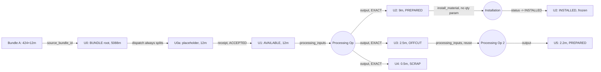

# SteelTrace — Physical Database Design

**Consolidated edition, Edition 2** (supersedes Revisions 1–3 as separate documents; this edition supersedes the first consolidated edition). Documentation only — no Prisma schema, SQL, migration, or application code has been generated or run; no database has been touched. This is the single, standalone, internally-consistent physical design for SteelTrace: PostgreSQL on Neon, accessed through Prisma ORM from a Node.js/TypeScript backend, shared schema, `company_id`-based tenant isolation.

**The first consolidated edition resolved six issues** found in review of the prior (addendum-style) Revision 3, in addition to carrying forward everything already approved in direction from Revisions 1–3: (1) `project_allocations` is now purely immutable, matching its own "append-only" description; (2) steel length semantics are now precise and consistent across every table — piece count, per-piece length, and aggregate length are three distinct, clearly-scoped concepts; (3) specification compatibility is now three-valued (confirmed match / confirmed incompatible / unknown) so a missing `standard` can never be silently treated as a match; (4) the full global-user/company-membership account lifecycle is specified, including a narrowly-scoped invitation mechanism that avoids ever exposing the global `users` table to ordinary requests; (5) concurrency safety no longer depends on backend developers remembering to lock anything — all multi-step mutations go through controlled database functions with built-in, self-verifying locking; (6) one transfer line receiving in several differently-dispositioned portions in a single receipt event is confirmed to work and is walked through explicitly. **A side effect of resolving issue 2 was finding and removing several redundant quantity columns** that duplicated information already carried by the `material_units` row a given event created or fully consumed — called out explicitly in §16.

**This edition (Edition 2) adds eight operational requirements** extracted directly from the client's own business documents — the Rebar Stock Management specification, the Inventory Control Excel template, and the structural BOQ/Rebar Schedule workbooks — rather than from working-session discussion: GRN receipt / opening stock / weighbridge / MTC / intake quarantine (§4, §12); rebar surface type and an expanded `spec_compare` (§1a, §4, §8); a rebar catalog and theoretical-weight engine (§3a, §14); Bar Bending Schedules, shape codes, and takeoff linkage (§3a, §9a); physical stock count and variance reconciliation (§9b, §9, §14); human-readable reference codes and storage sub-locations (§3, §4, §9); and maker-checker approval columns plus a new `attachments` table (§9, §15). See §22 for the full itemized changelog. Everything in §1–§21 below that is not called out as changed in §22 is unchanged from the first consolidated edition.

## 1. Conventions

- **Primary keys**: `id uuid NOT NULL DEFAULT gen_random_uuid()` on every table.
- **Tenant composite-key pattern**: every tenant-scoped table has `company_id uuid NOT NULL REFERENCES companies(id)` and `UNIQUE (company_id, id)`. Every reference to it from a child table is a **composite FK** `(company_id, parent_id) REFERENCES parent(company_id, id)`, not a bare FK on `parent_id` — this is what makes a cross-tenant relationship structurally impossible (§13). Stated once; each table below names only the referenced table, the composite form is implied unless noted. **`users` is the one exception** — it has no `company_id` (§6).
- **"Responsible actor" columns** are named `*_by_membership_id` and are composite FKs to `company_memberships`, never to `users` directly (§6) — every action is "this person, acting within this company."
- **Fixed/structural value sets are native Postgres `ENUM` types**; **company-configurable business sets are lookup tables**. Full enum list in §1a.
- **Units**: lengths in meters `numeric(10,3)`; weights in kilograms `numeric(10,3)`; diameters in millimeters `numeric(6,2)`. Metric only (`CLAUDE.md` §8 Q8, still open).
- **Immutable event tables** have no `UPDATE`/`DELETE` grant for the application database role. **Current-state columns** (on `material_units`, `material_transfers`, `processing_operations`) are the only columns ever updated in place, and only ever by the controlled functions in §12 — never directly by application code. §15 (Auditability) catalogs exactly which pattern each table uses and why.
- **No table stores a competing "current quantity."** Every quantity figure in this system is either (a) an immutable fact recorded once at row creation, or (b) a formula over such facts (§9). This is restated because it is the single most important invariant in the schema.

### 1a. Enum Types
`material_granularity_enum {BUNDLE, BATCH, PIECE}` · `material_classification_enum {ORIGINAL, PENDING_RECONCILIATION, PREPARED, OFFCUT, SCRAP}` · `material_status_enum {AVAILABLE, RESERVED, CONSUMED, DISPATCHED, INSTALLED, ON_HOLD}` · `reconciliation_status_enum {UNRECONCILED, BALANCED, ADJUSTED}` · `attribution_mode_enum {EXACT, KNOWN_PARTIAL, POOLED}` · `measurement_basis_enum {LENGTH, WEIGHT}` · `adjustment_type_enum {TOLERANCE, CORRECTION}` · `transfer_status_enum {DISPATCHED, PARTIALLY_RECEIVED, RECEIVED}` · `location_type_enum {WAREHOUSE, PROCESSING_AREA, SITE, OTHER}` · `record_status_enum {ACTIVE, SUPERSEDED}` · `release_type_enum {FULFILLED, CANCELLED, EXPIRED}` · `receipt_disposition_enum {ACCEPTED, ON_HOLD, DAMAGED_DISCREPANT}` · `invitation_status_enum {PENDING, ACCEPTED, REVOKED, EXPIRED}` · **new in Edition 2:** `bundle_origin_type_enum {OPENING_STOCK, GRN_PURCHASE}` · `rebar_surface_type_enum {DEFORMED, PLAIN}`.

## 2. Steel Length Semantics (resolves issue #2 — read this before any table below)

**The worked example this section is built around**: a supplier bundle of 424 bars, 12 m each, 5,088 m total. Three distinct concepts, never conflated:

| Concept | Meaning | Column |
|---|---|---|
| **Piece count** | How many physical bars/pieces this row represents | `quantity_pieces` (every granularity) |
| **Individual-piece length** | The length of **one** piece, *only when every piece in this row is the same length* | `unit_length_m` — **nullable** |
| **Aggregate length** | The total length of everything this row represents, always well-defined | `total_length_m` — **never null** |

- On `bundles`: `piece_count = 424`, `bar_length_m = 12` (per-bar, as printed on the supplier label — bundles are always uniform by definition, so this is `NOT NULL`). Total (5,088 m) is never stored on `bundles` — it's a trivial, always-correct multiplication, not a fact that needs its own column.
- On the bundle's root `material_units` row: `quantity_pieces = 424`, `unit_length_m = 12`, `total_length_m = 5088`. **Check constraint**: whenever `unit_length_m IS NOT NULL`, `total_length_m = unit_length_m * quantity_pieces` exactly.
- **Uniform batches** (the common case: a cutting operation produces five identical 2 m offcuts) keep `unit_length_m` populated (`= 2`), `total_length_m = 10`.
- **Mixed-length batches** (an operation produces four assorted, unmeasured-individually offcuts totaling 3.2 m) set `unit_length_m = NULL` — the aggregate (3.2 m) is still fully authoritative; there is simply no single per-piece figure to report. **Nothing is lost**: if an individual piece's dimension later matters, it is split off (`material_splits`, §4) into its own row with its own `quantity_pieces = 1` and a real `unit_length_m` — mixed-length batches never prevent recovering piece-level precision later, they just don't force it to exist before it's needed.
- **Weight** follows the identical pattern: `unit_weight_kg` (nullable, per-piece, rarely populated — scales weigh aggregates, not individual bars) and `total_weight_kg` (nullable — not every unit is ever actually weighed — but when both are present, the same consistency check applies).

**A major simplification found while making this precise**: in earlier drafts, several join tables (`processing_outputs`, `material_splits`, `material_transfer_lines`, `material_transfer_receipt_lines`, `installation_lines`) each carried their *own* `quantity_pieces`/`length_m` columns, duplicating a number already carried by the `material_units` row the event created or fully consumed. That duplication is a real data-integrity risk (two places that could silently disagree) and is removed throughout this edition — **the rule applied uniformly**: *if an event creates a dedicated new `material_units` row for exactly the amount in question, or consumes a unit's entire remaining quantity and then never touches it again, the quantity lives only on that `material_units` row.* The **one** deliberate exception is `processing_inputs` (§4): consuming part of a unit's quantity to feed a transformation does not, by itself, spawn a dedicated row for exactly that consumed amount (the consumed quantity is transformed into outputs, not preserved as its own row), so `processing_inputs` genuinely needs its own `quantity_consumed_pieces`/`length_consumed_m`. `project_allocations` (§5) also keeps its own quantity snapshot, for a different reason explained there (it reallocates a row that *remains active* and can keep changing afterward, unlike a freshly-created or terminally-consumed row — a snapshot is the only way to know what it was *at that moment*).

**One further simplification adopted here**: every `MaterialTransfer` dispatch now **always** creates a dedicated placeholder unit via a split, even when the *entire* remaining quantity of the source unit is moving — there is no special-cased "the same row just relocates" shortcut. This removes an edge case and is exactly what makes the redundancy-elimination above hold universally for transfers, with no exception needed.

## 3. Identity, Tenancy, Projects, Locations, Master Data

**`companies`**
| Column | Type | Null | Default |
|---|---|---|---|
| id | uuid | NO | gen_random_uuid() |
| name | text | NO | — |
| created_at | timestamptz | NO | now() |

**`users`** — **global**, no `company_id` (§6).
| Column | Type | Null | Default | Notes |
|---|---|---|---|---|
| id | uuid | NO | gen_random_uuid() | |
| email | text | NO | — | globally unique |
| display_name | text | NO | — | |
| auth_provider | text | NO | — | e.g. `"password"`, `"oidc:auth0"` |
| auth_provider_subject_id | text | YES | — | |
| password_hash | text | YES | — | prefer an external auth provider; this is a fallback, not the recommended path |
| is_active | boolean | NO | true | |
| created_at | timestamptz | NO | now() | |

- Unique: `(email)`; partial unique `(auth_provider, auth_provider_subject_id)` where not null.
- **No composite tenant key** — there is nothing to compose with.

**`company_memberships`** — the tenant-scoped bridge every "responsible actor" column points to.
| Column | Type | Null | Default | Notes |
|---|---|---|---|---|
| id | uuid | NO | gen_random_uuid() | |
| company_id | uuid | NO | — | FK → companies |
| user_id | uuid | NO | — | **plain** FK → users(id) — not composite, `users` has no `company_id` |
| role_id | uuid | NO | — | composite FK → roles |
| is_active | boolean | NO | true | |
| joined_at | timestamptz | NO | now() | |
| deactivated_at | timestamptz | YES | — | set once, with `deactivated_by_membership_id`, when `is_active` turns false |
| deactivated_by_membership_id | uuid | YES | — | composite FK → company_memberships (self) |

- Unique: `(company_id, user_id)`, `(company_id, id)`.
- **Never deleted** — the app role has no `DELETE` grant. "Removing" a membership is always `is_active → false` with the deactivation fields set; a hard delete would orphan every historical `*_by_membership_id` reference across the whole schema that pointed at it.

**`company_invitations`** — **new**, the narrowly-scoped mechanism that lets a company bring in a new or existing person without ever needing to look up (or expose) the global `users` table (§6).
| Column | Type | Null | Default | Notes |
|---|---|---|---|---|
| id | uuid | NO | gen_random_uuid() | |
| company_id | uuid | NO | — | FK → companies |
| invited_email | text | NO | — | looked up only at acceptance time, never used to search `users` beforehand |
| role_id | uuid | NO | — | composite FK → roles — the role the invitee will hold once accepted |
| invited_by_membership_id | uuid | NO | — | composite FK → company_memberships |
| invited_at | timestamptz | NO | now() | |
| expires_at | timestamptz | YES | — | |
| status | invitation_status_enum | NO | 'PENDING' | `PENDING \| ACCEPTED \| REVOKED \| EXPIRED` |
| token_hash | text | NO | — | hash of a single-use token emailed to the invitee; the raw token is never stored |
| accepted_user_id | uuid | YES | — | plain FK → users; set at acceptance, whether the invitee was a brand-new or pre-existing account |
| accepted_at | timestamptz | YES | — | |

- Unique: `(company_id, id)`.

**`roles`** — company-scoped master data.
| Column | Type | Null | Default |
|---|---|---|---|
| id | uuid | NO | gen_random_uuid() |
| company_id | uuid | NO | — |
| name | text | NO | — |
| created_at | timestamptz | NO | now() |

- Unique: `(company_id, name)`.

**`projects`**
| Column | Type | Null | Default |
|---|---|---|---|
| id | uuid | NO | gen_random_uuid() |
| company_id | uuid | NO | — |
| name | text | NO | — |
| building_type | text | YES | — |
| created_at | timestamptz | NO | now() |

**`storage_locations`**
| Column | Type | Null | Default | Notes |
|---|---|---|---|---|
| id | uuid | NO | gen_random_uuid() | |
| company_id | uuid | NO | — | |
| project_id | uuid | YES | — | null = company-wide (e.g. a central yard) |
| location_type | location_type_enum | NO | — | `WAREHOUSE \| PROCESSING_AREA \| SITE \| OTHER` |
| name | text | NO | — | |
| parent_storage_location_id | uuid | YES | — | **new, Edition 2** — composite FK → storage_locations (self); e.g. a bay's parent is its rack |
| zone_code | text | YES | — | **new, Edition 2** |
| rack_code | text | YES | — | **new, Edition 2** |
| bay_code | text | YES | — | **new, Edition 2** |
| created_at | timestamptz | NO | now() | |

- Index: `(company_id, project_id)`, `(company_id, parent_storage_location_id)`.
- **This is a physical storage sub-location hierarchy** (`CLAUDE.md` §2.18, `data-model.md` §23) — distinct from, and never joined with, `location_nodes` (the project *installation* hierarchy, below). Cycle-freedom on `parent_storage_location_id` is application-enforced, like `location_nodes`' (§17's noted limitation, extended to this new self-reference).

**`location_node_types`**
| Column | Type | Null | Default |
|---|---|---|---|
| id | uuid | NO | gen_random_uuid() |
| company_id | uuid | NO | — |
| name | text | NO | — |

- Unique: `(company_id, name)`.

**`location_nodes`** — self-referencing project installation-location hierarchy.
| Column | Type | Null | Default | Notes |
|---|---|---|---|---|
| id | uuid | NO | gen_random_uuid() | |
| company_id | uuid | NO | — | |
| project_id | uuid | NO | — | composite FK → projects |
| parent_id | uuid | YES | — | composite FK → location_nodes (self) |
| location_node_type_id | uuid | NO | — | composite FK → location_node_types |
| name | text | NO | — | |

- Index: `(company_id, project_id, parent_id)`. Cycle-freedom is application-enforced (flagged, §17).

**`suppliers`, `manufacturers`** (identical shape)
| Column | Type | Null | Default |
|---|---|---|---|
| id | uuid | NO | gen_random_uuid() |
| company_id | uuid | NO | — |
| name | text | NO | — |
| country | text | YES | — |

**`structural_element_types`, `reinforcement_purposes`** (identical shape, independent of each other)
| Column | Type | Null | Default |
|---|---|---|---|
| id | uuid | NO | gen_random_uuid() |
| company_id | uuid | NO | — |
| name | text | NO | — |
| is_active | boolean | NO | true |

- Unique: `(company_id, name)` on each.

**`processing_operation_types`**
| Column | Type | Null | Default | Notes |
|---|---|---|---|---|
| id | uuid | NO | gen_random_uuid() | |
| company_id | uuid | NO | — | |
| name | text | NO | — | e.g. "Cutting", "Bending" |
| requires_uniform_input_spec | boolean | NO | true | coarse, operation-level convenience default (§7) |
| is_active | boolean | NO | true | |

- Unique: `(company_id, name)`.

**`structural_element_instances`**
| Column | Type | Null | Default | Notes |
|---|---|---|---|---|
| id | uuid | NO | gen_random_uuid() | |
| company_id | uuid | NO | — | |
| project_id | uuid | NO | — | |
| structural_element_type_id | uuid | NO | — | |
| location_node_id | uuid | NO | — | |
| reference_code | text | NO | — | e.g. "C-12" |

- Unique: `(company_id, project_id, reference_code)`.

### 3a. Rebar Catalog and Shape Codes — new, Edition 2

Extracted from the client's Inventory Control Excel template, BOQ/Rebar Schedule workbooks, and Rebar Stock Management specification (`CLAUDE.md` §2.15, §2.16; `data-model.md` §20, §21). Both tables are company-scoped configurable master data, consistent with the existing rule against hardcoding structural element types/reinforcement purposes (§2.6 of `CLAUDE.md`).

**`rebar_catalog_items`**
| Column | Type | Null | Default | Notes |
|---|---|---|---|---|
| id | uuid | NO | gen_random_uuid() | |
| company_id | uuid | NO | — | |
| item_code | text | NO | — | e.g. "RB-D16-DEF" |
| diameter_mm | numeric(6,2) | NO | — | |
| surface_type | rebar_surface_type_enum | NO | 'DEFORMED' | `DEFORMED \| PLAIN` |
| default_grade | text | YES | — | |
| default_standard | text | YES | — | |
| standard_bar_length_m | numeric(10,3) | YES | — | |
| default_pieces_per_bundle | integer | YES | — | |
| linear_density_kg_per_m | numeric(8,4) | NO | — | set from the theoretical formula (`diameter_mm² / 162`) or a standard engineering lookup table — company's choice, never system-imposed (§14) |
| reorder_threshold_mt | numeric(10,3) | YES | — | metric tons |
| is_active | boolean | NO | true | |

- Unique: `(company_id, item_code)`.
- Check: `diameter_mm > 0`, `linear_density_kg_per_m > 0`.
- Reporting/QA only (§14) — never authoritative over any `material_units`/`bundles` quantity column.

**`shape_codes`**
| Column | Type | Null | Default | Notes |
|---|---|---|---|---|
| id | uuid | NO | gen_random_uuid() | |
| company_id | uuid | NO | — | |
| code | text | NO | — | e.g. "STIRRUP-A" |
| name | text | NO | — | |
| active_dimensions | text[] | NO | — | which of `bbs_lines`' `dim_a_mm`…`dim_r_mm` slots this shape actually uses (§9a) |
| is_active | boolean | NO | true | |

- Unique: `(company_id, code)`.

## 4. Bundles and Material Units

**`bundles`**
| Column | Type | Null | Default | Notes |
|---|---|---|---|---|
| id | uuid | NO | gen_random_uuid() | QR target |
| company_id | uuid | NO | — | |
| project_id | uuid | YES | — | |
| internal_reference_code | text | NO | — | |
| supplier_id | uuid | YES | — | |
| manufacturer_id | uuid | YES | — | |
| country_of_origin | text | YES | — | |
| diameter_mm | numeric(6,2) | NO | — | |
| grade | text | NO | — | supplier's original label text, preserved verbatim |
| grade_normalized | text | NO | — | trigger-maintained `upper(trim(grade))`, used for all comparisons |
| standard | text | YES | — | original label text; **often absent** (§8) |
| standard_normalized | text | YES | — | trigger-maintained from `standard`; null exactly when `standard` is null |
| heat_number | text | YES | — | |
| piece_count | integer | NO | — | |
| bar_length_m | numeric(10,3) | NO | — | per-bar length as printed on the label (§2) |
| surface_type | rebar_surface_type_enum | NO | 'DEFORMED' | **new, Edition 2** — `DEFORMED \| PLAIN`; inherited onto the root `material_units` row at registration, immutable thereafter (§8, §19 of `data-model.md`) |
| origin_type | bundle_origin_type_enum | NO | — | **new, Edition 2** — `OPENING_STOCK \| GRN_PURCHASE`; immutable fact about how the bundle entered the system (`CLAUDE.md` §2.13) |
| grn_reference | text | YES | — | **new, Edition 2** — populated for `GRN_PURCHASE` bundles |
| po_reference | text | YES | — | **new, Edition 2** |
| delivery_note_number | text | YES | — | **new, Edition 2** |
| vehicle_info | text | YES | — | **new, Edition 2** |
| weighbridge_ticket_number | text | YES | — | **new, Edition 2** |
| mtc_reference | text | YES | — | **new, Edition 2** — the mill's Material Test Certificate |
| actual_weight_kg | numeric(10,3) | YES | — | **new, Edition 2** — weighbridge-measured; compared against the catalog-derived theoretical weight (§14) |
| initial_disposition | receipt_disposition_enum | NO | 'ACCEPTED' | **new, Edition 2** — `ACCEPTED \| ON_HOLD \| DAMAGED_DISCREPANT`, reusing the same enum already defined for transfer receipts (§11); gates the root `material_units` row's starting `status` (§12's `register_bundle`) |
| approved_by_membership_id | uuid | YES | — | **new, Edition 2** — set once the initial disposition has been reviewed |
| approved_at | timestamptz | YES | — | **new, Edition 2** |
| registered_by_membership_id | uuid | NO | — | |
| registered_at | timestamptz | NO | now() | |

- Check: `piece_count > 0`, `diameter_mm > 0`, `bar_length_m > 0`.
- Check: `origin_type = 'OPENING_STOCK' OR grn_reference IS NOT NULL` — a GRN-purchase bundle must actually carry a GRN reference; opening stock, recorded once at launch, is exempt.
- Check: `(approved_by_membership_id IS NULL) = (approved_at IS NULL)`.
- Unique: `(company_id, internal_reference_code)`.
- Mutable master-data exception (§15): corrections are logged to `audit_log`.

**`bundle_attribute_definitions`** / **`bundle_attribute_values`** — unchanged extensible-field mechanism.
| Table | Column | Type | Null | Notes |
|---|---|---|---|---|
| bundle_attribute_definitions | id, company_id, name, data_type | uuid/uuid/text/text | NO | `data_type ∈ {TEXT,NUMBER,DATE}` |
| bundle_attribute_values | id, company_id, bundle_id, bundle_attribute_definition_id | uuid ×4 | NO | |
| | value_text / value_number / value_date | text/numeric/date | YES | exactly one populated, matching `data_type` |

- Unique: `(company_id, name)` / `(company_id, bundle_id, bundle_attribute_definition_id)`.

**`material_units`** — the generalized trackable quantity.
| Column | Type | Null | Default | Notes |
|---|---|---|---|---|
| id | uuid | NO | gen_random_uuid() | |
| company_id | uuid | NO | — | |
| project_id | uuid | YES | — | null = unallocated company-wide stock (§5) |
| source_bundle_id | uuid | YES | — | set only on a bundle-root unit |
| granularity | material_granularity_enum | NO | — | **immutable** |
| classification | material_classification_enum | NO | — | |
| status | material_status_enum | NO | — | `AVAILABLE \| RESERVED \| CONSUMED \| DISPATCHED \| INSTALLED \| ON_HOLD` |
| diameter_mm | numeric(6,2) | NO | — | inherited at creation, immutable |
| grade | text | NO | — | inherited, immutable, original text |
| grade_normalized | text | NO | — | inherited, immutable |
| standard | text | YES | — | inherited, immutable |
| standard_normalized | text | YES | — | inherited, immutable |
| surface_type | rebar_surface_type_enum | NO | — | **new, Edition 2** — inherited at creation, immutable, like diameter/grade/standard (§8, §19 of `data-model.md`) |
| quantity_pieces | integer | NO | — | §2 |
| unit_length_m | numeric(10,3) | YES | — | §2 — null if mixed-length |
| total_length_m | numeric(10,3) | NO | — | §2 — never null |
| unit_weight_kg | numeric(10,3) | YES | — | §2 |
| total_weight_kg | numeric(10,3) | YES | — | §2 |
| internal_reference_code | text | YES | — | **new, Edition 2** — human-readable (e.g. `ST-REM-0084` for a tagged reusable remnant/batch); optional, since not every unit is individually tagged (`CLAUDE.md` §2.18) |
| current_storage_location_id | uuid | YES | — | null while `INSTALLED` |
| created_at | timestamptz | NO | now() | |
| updated_at | timestamptz | NO | now() | only `classification`/`status`/`current_storage_location_id`/`project_id` ever change post-creation |

- Check: `quantity_pieces > 0`, `total_length_m > 0`.
- Check: `unit_length_m IS NOT NULL → total_length_m = unit_length_m * quantity_pieces`.
- Check: `unit_weight_kg IS NOT NULL AND total_weight_kg IS NOT NULL → total_weight_kg = unit_weight_kg * quantity_pieces`.
- Check: `granularity = 'BUNDLE' → classification = 'ORIGINAL'`.
- Check: `classification IN ('SCRAP','PENDING_RECONCILIATION') → status NOT IN ('CONSUMED','INSTALLED')`.
- **Trigger**: `status = 'ON_HOLD'` units cannot be referenced by `processing_inputs`, `material_reservations`, or `installation_lines` — this now also covers a bundle-root unit quarantined at intake (§12), not only a quarantined transfer-receipt portion (§11).
- Index: `(company_id, project_id, status)`, `(company_id, project_id, classification)`, `(source_bundle_id)`, partial `(company_id)` WHERE `project_id IS NULL AND status='AVAILABLE'`.
- Unique: partial `(company_id, internal_reference_code)` where not null.

**`material_unit_origins`** — materialized/derived cache, bundle-level backward genealogy. **Never authoritative** (§9).
| Column | Type | Null | Default | Notes |
|---|---|---|---|---|
| id | uuid | NO | gen_random_uuid() | |
| company_id | uuid | NO | — | |
| material_unit_id | uuid | NO | — | |
| bundle_id | uuid | NO | — | |
| contribution_weight | numeric(6,5) | **YES** | — | populated only when a real, traceable proportion exists; **never fabricated** (§10) |
| confidence | attribution_mode_enum | NO | — | the weakest tier encountered along the path — "sticky" |
| computed_at | timestamptz | NO | now() | |

- Unique: `(company_id, material_unit_id, bundle_id)`.
- Check: `contribution_weight IS NULL OR (contribution_weight > 0 AND contribution_weight <= 1)`.

## 5. Project Allocation — Pure Immutable History (resolves issue #1)

**`project_allocations`** — **changed: now purely immutable, no `released_at`.** Every row is an event; "current project" is the `material_units.project_id` projection, maintained from this history exactly the way `classification`/`status` are maintained from their own event tables — the same pattern, applied consistently, which is what the prior design's `released_at` column broke.
| Column | Type | Null | Default | Notes |
|---|---|---|---|---|
| id | uuid | NO | gen_random_uuid() | |
| company_id | uuid | NO | — | |
| material_unit_id | uuid | NO | — | |
| from_project_id | uuid | YES | — | null = previously unallocated |
| to_project_id | uuid | YES | — | null = returned to the unallocated pool |
| quantity_pieces | integer | NO | — | point-in-time snapshot (§2 explains why this one column set is *not* redundant, unlike similar columns removed elsewhere) |
| length_m | numeric(10,3) | NO | — | |
| allocated_by_membership_id | uuid | NO | — | |
| allocated_at | timestamptz | NO | now() | |
| reason | text | YES | — | |

- Check: `from_project_id IS NOT NULL OR to_project_id IS NOT NULL`.
- **Trigger, at insert**: `from_project_id` must equal `material_units.project_id` as it stands *immediately before* this insert (checked under the same row lock the controlling function already holds, §12); then `material_units.project_id` is set to `to_project_id`. No `UPDATE` ever touches a prior `project_allocations` row — "current" is simply "the row with the latest `allocated_at` for this unit," and the projection column makes that trivial to query without a window function every time.
- Index: `(company_id, material_unit_id, allocated_at DESC)`.
- **Whole-unit only**: reallocating part of a unit requires splitting it first (§2, §4's `material_splits`) — the snapshot columns record what the *whole* reallocated amount was, not a partial-amount parameter.
- **Never implies movement**: no trigger here reads or writes `current_storage_location_id`; only the `MaterialTransfer` family (§7) ever does. Ownership and physical location remain fully independent facts.
- **[PROPOSED — requires client validation, `CLAUDE.md` §8 Q16]**: the mechanism exists and is fully auditable; *who* is authorized to invoke it is still open.

## 6. Account Lifecycle (resolves issue #4)

**The bootstrapping problem, stated precisely**: a brand-new person has no `users` row and therefore no `company_memberships` row. If every write to `users` required an existing membership to authorize it (the ordinary RLS pattern used everywhere else), no one could ever be created. The fix is **privilege separation, not a backdoor**: ordinary application requests, running as the normal app database role under RLS, **never get `INSERT` on `users` at all** — that grant exists only for a narrow, dedicated identity-service code path.

**Registration** (a brand-new person, no invitation): the identity-service function validates the submitted email/auth-provider details and inserts the `users` row, running under a distinct Postgres role (e.g. `steeltrace_identity_service`) that holds `INSERT` on `users` — a grant the everyday app role does not have. No company context exists yet at this point, and none is required.

**Invitation** (a company brings someone in, existing account or not): a `company_invitations` row (§3) is created by an authorized member of the inviting company, by **email**, not by looking up a `users.id` — this is the detail that avoids the lookup problem (§6 would otherwise need the inviter to search `users` for someone who, by definition, may not be visible to them yet under the membership-gated policy below). At acceptance (the invitee clicks their emailed link), the identity-service path: (a) looks up `users` by the invited email — itself a privileged lookup, not a general-purpose one; (b) if no matching account exists, creates one (same registration mechanism as above); (c) creates the `company_memberships` row linking that `user_id` to the invitation's `company_id`/`role_id`; (d) marks the invitation `ACCEPTED` with `accepted_user_id`/`accepted_at`. All as one transaction, through the one privileged path — ordinary requests are never involved in resolving a `users` row by email.

**Activation/deactivation, removal**: `company_memberships.is_active` toggled by an authorized company admin via an ordinary, company-scoped request (no bootstrapping issue — this is a plain `UPDATE` within the admin's own company). "Removing" a membership is always deactivation, never deletion (§3) — the row is permanently referenced by every historical `*_by_membership_id` column that person ever touched.

**Belonging to multiple companies**: structurally automatic — a second `company_invitations` acceptance for the same `users.id` just creates a second `company_memberships` row at a different `company_id`, no special-casing needed.

**Updating a global profile** (display name, etc.): a **second** RLS policy on `users` (distinct from the membership-visibility one below), scoped to self-service: a session may `UPDATE` only the `users` row whose `id` matches its own authenticated identity, nothing else. This needs no company context and does not use the privileged identity-service role — profile editing is a normal, self-scoped request.

**Accessing company-specific roles/permissions**: resolved per request from the session's *currently selected* `company_memberships` row (§6a) — `role_id` → `roles`, ordinary company-scoped RLS, no special handling.

### 6a. Choosing "current company"
Not a table — a session concern. A person with several active memberships picks which company they're acting as (a UI company-switcher); the choice lives in the session/token, determining both `app.current_company_id` for RLS (§13) and which membership's `id` is written into every `*_by_membership_id` column for that request.

### 6b. RLS on the global `users` table, precisely
```sql
-- illustrative, not a migration
CREATE POLICY users_visible_via_membership ON users
  FOR SELECT USING (EXISTS (
    SELECT 1 FROM company_memberships cm
    WHERE cm.user_id = users.id AND cm.company_id = current_setting('app.current_company_id', true)::uuid
  ));
CREATE POLICY users_self_update ON users
  FOR UPDATE USING (id = current_setting('app.current_user_id', true)::uuid)
  WITH CHECK (id = current_setting('app.current_user_id', true)::uuid);
-- no INSERT policy for the ordinary app role: it holds no INSERT grant on users at all.
```
A company can see the global profile of someone who is **currently a member of that company**, and nothing more; a person can edit **their own** profile; no row can ever be created except through the identity-service role. This directly satisfies "do not solve the bootstrapping problem by giving ordinary requests unrestricted access."

## 7. Master-Data-Driven Specification Rules

Unchanged master data (`processing_operation_types.requires_uniform_input_spec`, §3) remains the coarse, operation-level convenience default. §8 defines the precise comparison logic it (and every finer-grained check) relies on.

## 8. Specification Compatibility — Three-Valued, Never Silently "Compatible" (resolves issue #3)

`diameter_mm`, `grade`/`grade_normalized`, and (**new, Edition 2**) `surface_type` are **always** present (`NOT NULL`) and therefore always definitively comparable. `standard`/`standard_normalized` is the **one** field that can be legitimately absent (many supplier labels never print one) — and absence must never be read as agreement. A single, explicit, three-valued function governs every spec comparison in this design (operation input-uniformity, `POOLED` candidate-set membership, output-spec inheritance):

```
spec_compare(a, b):
  if a.diameter_mm ≠ b.diameter_mm or a.grade_normalized ≠ b.grade_normalized or a.surface_type ≠ b.surface_type:
      → CONFIRMED_INCOMPATIBLE
  else if a.standard_normalized IS NOT NULL and b.standard_normalized IS NOT NULL:
      → CONFIRMED_MATCH if equal, else CONFIRMED_INCOMPATIBLE
  else:
      → UNKNOWN   -- at least one side's standard is simply not known
```

**Edition 2 addition**: `surface_type` (`DEFORMED | PLAIN`, `CLAUDE.md` §2.14) now participates alongside diameter/grade — a 12mm deformed bar and a 12mm plain bar of the same grade are `CONFIRMED_INCOMPATIBLE`, never merely `UNKNOWN`, since both sides' surface type is always known.

**Default policy, stated once, applied everywhere spec compatibility gates a write**: only `CONFIRMED_MATCH` counts as compatible. `UNKNOWN` is treated **the same as `CONFIRMED_INCOMPATIBLE`** for every automated/trigger-enforced purpose — a missing `standard` blocks automatic combination exactly as a genuinely different one would, satisfying "a NULL or missing standard must not automatically be treated as evidence of compatibility" as literally as possible (it isn't treated as evidence of *either* compatibility or incompatibility — it's treated as insufficient grounds to proceed automatically).

**The practical path when two units are, in reality, almost certainly compatible but one simply never had a standard recorded**: correct the `standard` field through the ordinary `bundles` master-data correction path (logged to `audit_log`, §15) — turning `UNKNOWN` into a real `CONFIRMED_MATCH` through an already-audited, already-existing mechanism, rather than adding a parallel override/equivalence system. **A dedicated equivalence-declaration table remains a reasonable future enhancement** if this manual-correction path proves too frequent in practice — deliberately not built now, since nothing today indicates it's needed (§18).

**Validation rules, restated against this function**:
- Operation input-uniformity (`requires_uniform_input_spec = true`): every pair of `processing_inputs` in the operation must be `spec_compare(...) = CONFIRMED_MATCH`.
- `POOLED` output attribution candidate set = every `processing_input` of the operation where `spec_compare(input, output) = CONFIRMED_MATCH` — must be non-empty (§7's mixed-spec rule, carried forward unchanged in substance, restated here against the precise three-valued function instead of a loose equality check).
- `EXACT`/`KNOWN_PARTIAL` named sources must be pairwise `CONFIRMED_MATCH` with each other and with the output.
- **Original label values are always preserved** (`grade`/`standard`, verbatim) alongside the normalized comparison columns (`grade_normalized`/`standard_normalized`) — nothing about this comparison logic ever touches or hides the original transcription.

## 9. Processing, Splits, Reservations, Holds, Reclassification, Adjustments

**`work_orders`**
| Column | Type | Null | Default | Notes |
|---|---|---|---|---|
| id, company_id, project_id | uuid | NO | — | |
| reference_code | text | NO | — | |
| description | text | YES | — | |
| bbs_line_id | uuid | YES | — | **new, Edition 2** — composite FK → bbs_lines (§9a); optional, since not every work order originates from a formal takeoff line |
| created_by_membership_id | uuid | NO | — | |
| created_at | timestamptz | NO | now() | |

- Unique: `(company_id, project_id, reference_code)`.

**`processing_operations`**
| Column | Type | Null | Default | Notes |
|---|---|---|---|---|
| id, company_id, project_id | uuid | NO | — | |
| work_order_id | uuid | YES | — | |
| reference_code | text | NO | — | **new, Edition 2** — human-readable (e.g. `ST-PROC-0021`, `CLAUDE.md` §2.18) |
| operation_type_id | uuid | NO | — | |
| storage_location_id | uuid | NO | — | where the cutting/bending happens; must be `location_type='PROCESSING_AREA'` (trigger) |
| performed_by_membership_id | uuid | NO | — | |
| performed_at | timestamptz | NO | now() | |
| checked_by_membership_id | uuid | YES | — | **new, Edition 2** — maker-checker (`CLAUDE.md` §2.19); distinct person from `performed_by_membership_id` |
| checked_at | timestamptz | YES | — | **new, Edition 2** |
| idempotency_key | text | YES | — | |
| reconciliation_status | reconciliation_status_enum | NO | 'UNRECONCILED' | projection, maintained by trigger/function (§10, §12) |
| is_finalized | boolean | NO | false | finalization gate (§10, §12) |

- Unique: `(company_id, reference_code)`; partial `(company_id, idempotency_key)` where not null.
- Check: `(checked_by_membership_id IS NULL) = (checked_at IS NULL)`.
- Index: `(company_id, project_id, performed_at)`, `(work_order_id)`.

**`processing_inputs`** — **the one join table that keeps its own quantity (§2)**.
| Column | Type | Null | Default |
|---|---|---|---|
| id, company_id | uuid | NO | — |
| processing_operation_id, material_unit_id | uuid | NO | — |
| quantity_consumed_pieces | integer | NO | — |
| length_consumed_m | numeric(10,3) | NO | — |
| weight_consumed_kg | numeric(10,3) | YES | — |
| created_at | timestamptz | NO | now() |

- Check: both quantities `> 0`.
- **Trigger**: referenced unit's `current_storage_location_id` must equal the operation's `storage_location_id` (material must already be at the processing area — brought there by a prior `MaterialTransfer`).
- Index: `(material_unit_id)`, `(processing_operation_id)`.

**`processing_outputs`** — **simplified**: no quantity columns (§2); the created `material_units` row carries them.
| Column | Type | Null | Default |
|---|---|---|---|
| id, company_id | uuid | NO | — |
| processing_operation_id | uuid | NO | — |
| material_unit_id | uuid | NO | — |
| attribution_mode | attribution_mode_enum | NO | — |
| created_at | timestamptz | NO | now() |

- Unique: `(company_id, material_unit_id)`.
- **Trigger**: enforces the four valid `(attribution_mode, processing_output_sources row count)` shapes (§10) and the §8 spec rules; sets the new unit's `current_storage_location_id = processing_operations.storage_location_id`.

**`processing_output_sources`**
| Column | Type | Null | Default |
|---|---|---|---|
| id, company_id | uuid | NO | — |
| processing_output_id, processing_input_id | uuid | NO | — |
| contribution_weight | numeric(6,5) | YES | — |
| created_at | timestamptz | NO | now() |

- Unique: `(company_id, processing_output_id, processing_input_id)`.
- Check: `contribution_weight IS NULL OR (contribution_weight > 0 AND contribution_weight <= 1)`.

**`material_splits`** — **simplified**: no quantity columns.
| Column | Type | Null | Default |
|---|---|---|---|
| id, company_id | uuid | NO | — |
| source_material_unit_id, resulting_material_unit_id | uuid | NO | — |
| reason | text | NO | — |
| recorded_by_membership_id | uuid | NO | — |
| created_at | timestamptz | NO | now() |

- Unique: `(company_id, resulting_material_unit_id)`.
- **Trigger**: source and resulting units' `current_storage_location_id` must be equal (no relocation — that's `MaterialTransfer`'s job).

**`material_reservations`** — whole-unit only (§14).
| Column | Type | Null | Default | Notes |
|---|---|---|---|---|
| id, company_id, material_unit_id | uuid | NO | — | |
| intended_usage_declaration_id | uuid | YES | — | |
| bbs_line_id | uuid | YES | — | **new, Edition 2** — composite FK → bbs_lines (§9a); optional takeoff-fulfillment link |
| reserved_by_membership_id | uuid | NO | — | |
| reserved_at | timestamptz | NO | now() | |
| expires_at | timestamptz | YES | — | |
| released_at | timestamptz | YES | — | |
| released_by_membership_id | uuid | YES | — | null only for an automated expiry |
| release_type | release_type_enum | YES | — | `FULFILLED \| CANCELLED \| EXPIRED` |
| release_reason | text | YES | — | |

- Check: `released_at IS NOT NULL ⟺ release_type IS NOT NULL`.
- Unique: partial `(company_id, material_unit_id)` where `released_at IS NULL`.
- Expiry sweep is an application-scheduled job, not a DB-native mechanism (noted, not built).

**`material_hold_releases`** — **new**, releases a unit born `ON_HOLD` (§11).
| Column | Type | Null | Default |
|---|---|---|---|
| id, company_id, material_unit_id | uuid | NO | — |
| released_by_membership_id | uuid | NO | — |
| released_at | timestamptz | NO | now() |
| reason | text | NO | — |

- Unique: `(company_id, material_unit_id)` — plain (a unit can only be held once, at birth, in this design).
- **Trigger**: sets the unit's `status` (must currently be `ON_HOLD`) → `AVAILABLE`.

**`conservation_adjustments`**
| Column | Type | Null | Default | Notes |
|---|---|---|---|---|
| id, company_id | uuid | NO | — | |
| processing_operation_id | uuid | YES | — | |
| material_transfer_line_id | uuid | YES | — | |
| physical_stock_count_line_id | uuid | YES | — | **new, Edition 2** — composite FK → physical_stock_count_lines (§9b) |
| measurement_basis | measurement_basis_enum | NO | — | `LENGTH \| WEIGHT` |
| amount | numeric(10,3) | NO | — | **signed** — see §10 |
| adjustment_type | adjustment_type_enum | NO | — | `TOLERANCE \| CORRECTION` |
| reason | text | NO | — | |
| recorded_by_membership_id | uuid | NO | — | |
| approved_by_membership_id | uuid | YES | — | **new, Edition 2** — maker-checker (`CLAUDE.md` §2.19) |
| approved_at | timestamptz | YES | — | **new, Edition 2** |
| created_at | timestamptz | NO | now() | |

- Check (**updated, Edition 2**): exactly one of `(processing_operation_id, material_transfer_line_id, physical_stock_count_line_id)` is `NOT NULL` — the polymorphic reference now has three possible targets instead of two, so the prior two-way `<>` check becomes a three-way "exactly one of three" check: `num_nonnulls(processing_operation_id, material_transfer_line_id, physical_stock_count_line_id) = 1`.
- Check: `(approved_by_membership_id IS NULL) = (approved_at IS NULL)`.

**`intended_usage_declarations`**
| Column | Type | Null | Default |
|---|---|---|---|
| id, company_id | uuid | NO | — |
| processing_operation_id | uuid | YES | — |
| processing_output_id | uuid | YES | — |
| structural_element_type_id | uuid | YES | — |
| structural_element_instance_id | uuid | YES | — |
| location_node_id | uuid | YES | — |
| reinforcement_purpose_id | uuid | NO | — |
| bbs_line_id | uuid | YES | — |
| declared_by_membership_id | uuid | NO | — |
| declared_at | timestamptz | NO | now() |
| status | record_status_enum | NO | 'ACTIVE' |
| supersedes_id | uuid | YES | — |

- Check: exactly one of `processing_operation_id`/`processing_output_id` set (operation-level, before outputs exist, vs. output-level, once a specific output needs its own destination).
- Check: `structural_element_type_id IS NOT NULL OR structural_element_instance_id IS NOT NULL`.
- `bbs_line_id` (**new, Edition 2**) — composite FK → bbs_lines (§9a); optional takeoff-fulfillment link, consistent with the same optional link on `work_orders`/`material_reservations`.

**`reclassification_events`**
| Column | Type | Null | Default |
|---|---|---|---|
| id, company_id, material_unit_id | uuid | NO | — |
| from_classification, to_classification | material_classification_enum | NO | — |
| reason | text | NO | — |
| recorded_by_membership_id | uuid | NO | — |
| approved_by_membership_id | uuid | YES | — |
| approved_at | timestamptz | YES | — |
| created_at | timestamptz | NO | now() |

- Check (trigger): `(from, to)` must be a valid pair — `PENDING_RECONCILIATION→{PREPARED,OFFCUT,SCRAP}`, `OFFCUT→SCRAP`.
- Check: `(approved_by_membership_id IS NULL) = (approved_at IS NULL)`.
- `approved_by_membership_id`/`approved_at` (**new, Edition 2**) — maker-checker (`CLAUDE.md` §2.19): the reclassification (e.g. offcut → scrap) is recorded by one actor and may be reviewed/approved by a distinct second actor.

### 9a. Bar Bending Schedules (BBS) — new, Edition 2

Extracted from the client's structural BOQ/Rebar Schedule workbooks (`CLAUDE.md` §2.16, `data-model.md` §21). `bbs_schedules`/`bbs_lines` hold engineering takeoff data natively; `shape_codes` (§3a) is the company-scoped catalog of bent-bar profiles they reference.

**`bbs_schedules`**
| Column | Type | Null | Default | Notes |
|---|---|---|---|---|
| id, company_id, project_id | uuid | NO | — | |
| reference_code | text | NO | — | |
| drawing_number | text | YES | — | |
| drawing_revision | text | YES | — | |
| wastage_allowance_pct | numeric(5,2) | YES | — | |
| status | record_status_enum | NO | 'ACTIVE' | `ACTIVE \| SUPERSEDED` (§15's supersede-chain pattern) |
| prepared_by_membership_id | uuid | NO | — | the "maker" |
| approved_by_membership_id | uuid | YES | — | the "checker" (§2.19) |
| approved_at | timestamptz | YES | — | |
| created_at | timestamptz | NO | now() | |

- Unique: `(company_id, project_id, reference_code)`.
- Check: `(approved_by_membership_id IS NULL) = (approved_at IS NULL)`.

**`bbs_lines`**
| Column | Type | Null | Default | Notes |
|---|---|---|---|---|
| id, company_id | uuid | NO | — | |
| bbs_schedule_id | uuid | NO | — | |
| structural_element_type_id | uuid | YES | — | |
| structural_element_instance_id | uuid | YES | — | |
| location_node_id | uuid | YES | — | |
| reinforcement_purpose_id | uuid | NO | — | |
| bar_mark | text | NO | — | |
| diameter_mm | numeric(6,2) | NO | — | |
| surface_type | rebar_surface_type_enum | NO | 'DEFORMED' | `DEFORMED \| PLAIN` |
| grade_normalized | text | NO | — | |
| shape_code_id | uuid | NO | — | composite FK → shape_codes (§3a) |
| dim_a_mm, dim_b_mm, dim_c_mm, dim_d_mm, dim_e_mm, dim_r_mm | numeric(8,2) | YES | — | populated per `shape_codes.active_dimensions` for this line's shape; irrelevant slots stay null |
| cut_length_m | numeric(10,3) | NO | — | |
| bars_per_member | integer | NO | — | |
| member_count | integer | NO | — | |
| total_bars_required | integer | NO | — | derived as `bars_per_member * member_count` at the application layer; stored for direct reporting, not a competing figure since it is never independently entered |

- Check: `structural_element_type_id IS NOT NULL OR structural_element_instance_id IS NOT NULL` — mirrors `intended_usage_declarations`' same rule.
- Check: `cut_length_m > 0`, `bars_per_member > 0`, `member_count > 0`, `total_bars_required = bars_per_member * member_count`.
- Index: `(company_id, bbs_schedule_id)`, `(shape_code_id)`.
- **Optional fulfillment linkage**: `work_orders.bbs_line_id`, `material_reservations.bbs_line_id`, `intended_usage_declarations.bbs_line_id` (all added above) each may reference a `bbs_lines` row — nullable, since not every real operation originates from a formal takeoff line.
- **Multi-spec members never require a multi-spec `bbs_line` or a multi-spec `ProcessingOperation`**: a precast cage combining plain and deformed bars of different diameters is simply several `bbs_lines` (one per spec) feeding, downstream, several single-spec `InstallationLine` rows against one `StructuralElementInstance` (`CLAUDE.md` §8 Q11, `data-model.md` §21).

### 9b. Physical Stock Count & Variance Reconciliation — new, Edition 2

Extracted from the client's Inventory Control Excel template (`CLAUDE.md` §2.17, `data-model.md` §22). A third kind of reconciling event, alongside `processing_operations` and `material_transfers` — hence `conservation_adjustments`' extended three-way polymorphic reference (§9, above).

**`physical_stock_counts`**
| Column | Type | Null | Default | Notes |
|---|---|---|---|---|
| id, company_id | uuid | NO | — | |
| storage_location_id | uuid | NO | — | |
| reference_code | text | NO | — | |
| count_date | date | NO | — | |
| status | record_status_enum | NO | 'ACTIVE' | `ACTIVE \| SUPERSEDED` |
| counted_by_membership_id | uuid | NO | — | the "maker" |
| verified_by_membership_id | uuid | YES | — | the "checker" (§2.19) |
| verified_at | timestamptz | YES | — | |
| notes | text | YES | — | |
| created_at | timestamptz | NO | now() | |

- Unique: `(company_id, reference_code)`.
- Check: `(verified_by_membership_id IS NULL) = (verified_at IS NULL)`.

**`physical_stock_count_lines`**
| Column | Type | Null | Default | Notes |
|---|---|---|---|---|
| id, company_id | uuid | NO | — | |
| physical_stock_count_id | uuid | NO | — | |
| material_unit_id | uuid | NO | — | |
| system_pieces | integer | NO | — | snapshot of `material_units.quantity_pieces` at count time |
| system_length_m | numeric(10,3) | NO | — | snapshot of `remaining(unit)` (§14) at count time |
| counted_pieces | integer | NO | — | |
| counted_length_m | numeric(10,3) | NO | — | |
| variance_length_m | numeric(10,3) | NO | — | `counted_length_m - system_length_m`; **signed**, same convention as `conservation_adjustments.amount` (§10) |
| investigation_notes | text | YES | — | |

- Unique: `(company_id, physical_stock_count_id, material_unit_id)`.
- Check: `variance_length_m = counted_length_m - system_length_m`.
- **A variance is not itself a write to inventory** — it is only a recorded observation until a corresponding `conservation_adjustments` row (referencing this line, §9) is created and, per the maker-checker rule, approved; until then the unit's own `remaining()` (§14) is unaffected, consistent with "discrepancies must never silently disappear, but also never silently auto-apply" (`CLAUDE.md` §2.5/§2.17).

## 10. Material Conservation — One Equation, One Sign Convention

```
Σ(inputs) = Σ(outputs) + Σ(adjustments)
```
- **Processing**: inputs = `Σprocessing_inputs.length_consumed_m`; outputs = `Σ` of the length (`total_length_m`) of every `material_units` row created via this operation's `processing_outputs`; adjustments = `Σconservation_adjustments.amount WHERE processing_operation_id = …`.
- **Transfer** (per line): inputs = the placeholder unit's own `total_length_m` (§2 — always exactly the dispatched amount, since dispatch always splits); outputs = `Σ` of the length of every `material_units` row created via `material_transfer_receipt_lines` against this line; adjustments = `Σconservation_adjustments.amount WHERE material_transfer_line_id = …`.
- **Sign** (one convention, used everywhere): `amount > 0` = missing from the output/received side (loss, shrinkage, an unlogged offcut — the ordinary case). `amount < 0` = output/received recorded as exceeding input/dispatched — valid only as a correction to a prior measurement error; surfaced as a UI warning, not blocked.
- **Enforcement**: an immediate, self-locking trigger (§12) blocks `Σoutputs > Σinputs + Σadjustments` the instant it would occur. Under-accounting is allowed to sit visibly `UNRECONCILED` until the operation is finalized or the transfer line is fully resolved (§12) — never silently dropped either way.
- **Weight**: evaluated identically, only when weight data exists on both sides of a given comparison; absence never blocks and is never silently treated as balanced — it simply opts out of that check.
- **Attribution and conservation are independent**: a `POOLED` output's length counts fully toward `Σoutputs` regardless of how (or whether) its origin can be attributed.

**Four valid `(attribution_mode, processing_output_sources)` shapes, enforced by trigger (resolves part of issue #5 from the prior round, restated here against §8's precise comparison)**:
1. `EXACT` — exactly one source row, `contribution_weight = 1`.
2. `KNOWN_PARTIAL`, weighted — ≥1 source rows, weights populated, summing to 1.
3. `KNOWN_PARTIAL`, unweighted — ≥1 source rows, weights null (known set, unknown split).
4. `POOLED` — zero source rows; implicit candidate set = the operation's inputs that are `spec_compare(...) = CONFIRMED_MATCH` with the output; must be non-empty.

**`material_unit_origins.contribution_weight`** is populated only when every step on a path back to a bundle was `EXACT` or weighted `KNOWN_PARTIAL`; the moment any step is `POOLED` or unweighted `KNOWN_PARTIAL`, it is `NULL` on every row for that path, and `confidence` records the weakest tier encountered — "sticky," never upgraded by a later exact step (§20's worked example demonstrates this explicitly).

## 11. Receiving, Transfers, and Multiple Dispositions Per Receipt (resolves issue #6)

**`material_transfers`**
| Column | Type | Null | Default |
|---|---|---|---|
| id, company_id, project_id | uuid | NO | — |
| from_location_id, to_location_id | uuid | NO | — |
| status | transfer_status_enum | NO | 'DISPATCHED' |
| dispatched_by_membership_id | uuid | NO | — |
| dispatched_at | timestamptz | NO | now() |
| vehicle_info | text | YES | — |
| idempotency_key | text | YES | — |
| reconciliation_status | reconciliation_status_enum | NO | 'UNRECONCILED' |

- Check: `from_location_id <> to_location_id` — a transfer that moves nothing is rejected outright.
- Unique: partial `(company_id, idempotency_key)` where not null.
- **Trigger** gates `status → 'RECEIVED'`: every line's placeholder must have `remaining() = 0` (§9, below).

**`material_transfer_lines`** — **simplified**: no quantity columns (§2); always a freshly split placeholder.
| Column | Type | Null | Default |
|---|---|---|---|
| id, company_id | uuid | NO | — |
| material_transfer_id | uuid | NO | — |
| material_unit_id | uuid | NO | — |
| split_from_material_unit_id | uuid | **NO** | — |
| created_at | timestamptz | NO | now() |

- Unique: `(company_id, material_unit_id)`.

**`material_transfer_receipts`** — one transfer, many receipt events over time.
| Column | Type | Null | Default |
|---|---|---|---|
| id, company_id, material_transfer_id | uuid | NO | — |
| received_by_membership_id | uuid | NO | — |
| received_at | timestamptz | NO | now() |
| notes | text | YES | — |

**`material_transfer_receipt_lines`** — **simplified** (no quantity columns, §2), **plus `disposition` (resolves issue #2)**. One receipt event may contain **several** rows against the **same** `material_transfer_line_id`, each with its own disposition and its own freshly materialized unit — this is exactly what makes multiple dispositions within one receipt work (below).
| Column | Type | Null | Default | Notes |
|---|---|---|---|---|
| id, company_id | uuid | NO | — | |
| material_transfer_receipt_id | uuid | NO | — | |
| material_transfer_line_id | uuid | NO | — | the placeholder being drawn down |
| resulting_material_unit_id | uuid | NO | — | freshly created; `quantity_pieces`/`total_length_m` live here (§2) |
| disposition | receipt_disposition_enum | NO | **'ACCEPTED'** | `ACCEPTED \| ON_HOLD \| DAMAGED_DISCREPANT` — default makes QC optional |
| created_at | timestamptz | NO | now() |

- Unique: `(company_id, resulting_material_unit_id)`.
- **Trigger**, at insert: the new `material_units` row's `status` = `AVAILABLE` if `disposition='ACCEPTED'`, else `ON_HOLD`; its `current_storage_location_id` = the transfer's `to_location_id` (same for every portion, regardless of disposition — disposition affects *usability*, never *location*); its spec is inherited unchanged from the placeholder (a transfer never mixes specs, so there is no ambiguity to resolve across differently-dispositioned portions).
- **Trigger**, cumulative check: `Σ(this line's resulting units' total_length_m) + Σ(conservation_adjustments.amount > 0 for this line) ≤ placeholder.total_length_m` at all times, **summed across every disposition indiscriminately** — a damaged or held portion still physically arrived and is still accounted for; only genuine non-arrival needs an adjustment. This is the precise answer to "how are cumulative receipt quantities, losses, and adjustments prevented from exceeding the dispatched quantity": the check sums every receipt-line row (any disposition) plus every adjustment for that line, and blocks the instant that sum would exceed what was dispatched — disposition is irrelevant to this arithmetic by design.

**Worked confirmation of the example given**: a line dispatched 10 m. One `material_transfer_receipts` event carries three `material_transfer_receipt_lines` rows against it: 8 m `ACCEPTED` (→ unit A, `AVAILABLE`), 1 m `DAMAGED_DISCREPANT` (→ unit B, `ON_HOLD`), 1 m `ON_HOLD` (→ unit C, `ON_HOLD`) — `8+1+1 = 10 =` dispatched exactly, no adjustment needed, `remaining(placeholder) → 0`, the line (and, once every line agrees, the transfer) can reach `RECEIVED`. Each of A/B/C has the correct, independently-tracked quantity (from its own row), status (per its own disposition), location (all three: the transfer's destination), specification (all three: inherited unchanged from the placeholder), and genealogy (each traces back through its own `material_transfer_receipt_lines` row → the placeholder → wherever the placeholder itself came from).

**`material_units.status = 'ON_HOLD'`**, from either `DAMAGED_DISCREPANT` or plain `ON_HOLD` receipt dispositions, is released only via `material_hold_releases` (§9) → `AVAILABLE`; if genuinely unusable, an ordinary `reclassification_events` row then moves it to `SCRAP` — composing two small, already-existing mechanisms rather than a third bespoke one.

### 11a. Installation — closing a documentation gap (new, this edition)

**Gap found during Task 2 (Prisma schema generation) and closed here**: every other one of this document's 46 tables got a column-by-column definition; `installations`/`installation_lines` were referenced throughout (§9's redundant-quantity list, §14's formulas, §15's auditability table, §18's indexing table, §21's ERD/table catalog) but never actually tabulated. This section is that missing definition — canonical from this point forward, superseding the Task 2 schema's inferred columns (which, notably, had guessed `structural_element_instance_id`/`reinforcement_purpose_id` onto `installation_lines`; the canonical shape below puts them on `installations` instead — matching §15's Example D, where **one** `Installation` for one element/purpose has **several** `InstallationLine` rows, one per source `MaterialUnit`, not the other way around).

**`installations`** — one installation event, for one structural element and one reinforcement purpose, possibly multi-source (§2.11 of `CLAUDE.md`). Supersede-chain pattern (§15), now also carrying its own maker-checker site QC sign-off (the same combination `bbs_schedules` already uses, §9a).
| Column | Type | Null | Default | Notes |
|---|---|---|---|---|
| id | uuid | NO | gen_random_uuid() | PK |
| company_id | uuid | NO | — | FK → companies |
| project_id | uuid | NO | — | composite FK → projects |
| structural_element_instance_id | uuid | NO | — | composite FK → structural_element_instances (carries element type, reference code e.g. "C-12", and `location_node_id`) |
| reinforcement_purpose_id | uuid | NO | — | composite FK → reinforcement_purposes |
| intended_usage_declaration_id | uuid | YES | — | composite FK → intended_usage_declarations (links actual installation to pre-declared intended use, §2.7) |
| bbs_line_id | uuid | YES | — | composite FK → bbs_lines (links installation to the planned BBS mark, §9a) |
| installed_by_membership_id | uuid | NO | — | composite FK → company_memberships |
| installed_at | timestamptz | NO | now() | |
| verified_by_membership_id | uuid | YES | — | composite FK → company_memberships (maker-checker site QC sign-off, `CLAUDE.md` §2.19) |
| verified_at | timestamptz | YES | — | |
| status | record_status_enum | NO | 'ACTIVE' | `ACTIVE \| SUPERSEDED` (§15 supersede-chain) |
| supersedes_id | uuid | YES | — | composite FK → installations(company_id, id) (self) |
| notes | text | YES | — | |

- Unique: `(company_id, id)`.
- Index: `(company_id, project_id, installed_at)`, `(company_id, structural_element_instance_id)`.
- Check: `(verified_by_membership_id IS NULL) = (verified_at IS NULL)`.

**`installation_lines`** — "this unit was installed, in full, as part of this installation." Pure immutable event log (§15/§16) — **no quantity/length/weight columns**, because installation always consumes the entire `material_units` row it references (`install_material` has no partial-amount parameter at all, §12).
| Column | Type | Null | Default | Notes |
|---|---|---|---|---|
| id | uuid | NO | gen_random_uuid() | PK |
| company_id | uuid | NO | — | FK → companies |
| installation_id | uuid | NO | — | composite FK → installations |
| material_unit_id | uuid | NO | — | composite FK → material_units |
| created_at | timestamptz | NO | now() | |

- Unique: `(company_id, id)`, `(company_id, installation_id, material_unit_id)`.
- Index: `(material_unit_id)`, `(installation_id)`.
- **A unit is installed at most once, ever** — per `data-model.md` §7's invariant, enforced by `install_material` requiring `status IN ('AVAILABLE','RESERVED')` before it ever sets `status → 'INSTALLED'` (a unit already `INSTALLED` fails that precondition on any second attempt), not by a uniqueness constraint on `material_unit_id` alone (which would incorrectly forbid the *correction* path: a superseded `Installation`'s lines legitimately keep referencing a unit that a new, superseding `Installation`'s lines also reference).

## 12. Transaction Safety, Locking, and Controlled Functions (resolves issue #5)

**The concern, stated plainly**: an earlier draft of this design relied on *application code remembering* to lock a `ProcessingOperation` row before recomputing its aggregate reconciliation status. That is exactly the kind of guarantee that should not depend on every backend developer getting it right every time. **The fix adopted here is defense in depth, not a choice between the two options offered — both are used together:**

1. **Controlled database functions are the only sanctioned write path** for every multi-row mutation: `register_bundle(...)` **(new, Edition 2)**, `record_processing_operation(...)`, `dispatch_material_transfer(...)`, `receive_transfer_line(...)`, `split_material_unit(...)`, `reallocate_project(...)`, `release_hold(...)`, `reclassify_material_unit(...)`, `install_material(...)`, `supersede_installation(...)`, `record_physical_stock_count(...)` **(new, Edition 2)**. The ordinary application database role has **no direct `INSERT`/`UPDATE` grant** on `processing_inputs`, `processing_outputs`, `material_transfer_lines`, `material_transfer_receipt_lines`, `material_splits`, `project_allocations`, `material_hold_releases`, `installations`, `installation_lines`, `reclassification_events`, or `physical_stock_count_lines` — only `EXECUTE` on these functions. **No direct `INSERT`** on `bundles` or `material_units` either — `register_bundle` is the only path that creates the paired bundle-root rows; ordinary `UPDATE` on `bundles`' own label-correction fields remains permitted per §15's mutable-master-data pattern, but creating a new bundle (with its atomically-paired root `material_units` row) is not an ordinary insert. This is option (b) from your instruction, made the *default*, not an afterthought: locking order and transaction shape are defined in exactly one place, not re-implemented per feature.
2. **Each function's own first action is to acquire every lock it needs**, in the fixed global order below, *before* any read used for a validation decision — so the guarantee holds even if a future function is written carelessly, because the locking is the first line of its body, not something left to its caller.
3. **Validation triggers additionally self-lock** (`SELECT … FOR UPDATE` on the row being validated, as their own first action) as a second, independent backstop — so the guarantee holds even if a *function* somehow failed to lock correctly. No single layer is trusted alone.

**Global lock ordering, applied by every function uniformly**: (a) lock the parent event row first, if it already exists (a `processing_operations` or `material_transfers` row being added to) — a brand-new insert has nothing to lock yet; (b) then lock every directly-referenced `material_units` row, **sorted by `id` ascending**. This single, centrally-defined order is what prevents deadlocks between *any two* of these functions, not just within one — because every one of them follows the same rule, not independently-chosen ones.

**Function-by-function locking summary**:
- `register_bundle` **(new, Edition 2)**: a brand-new insert, nothing to lock. Validates `(company_id, internal_reference_code)` uniqueness, inserts the `bundles` row, then inserts its root `material_units` row in the same transaction — atomically, exactly like every other "creates a child unit" path (§5). The root unit's starting `status` is set from `bundles.initial_disposition`: `'ACCEPTED' → 'AVAILABLE'`; `'ON_HOLD'` or `'DAMAGED_DISCREPANT' → 'ON_HOLD'` (quarantined — blocked from `processing_inputs`/`material_reservations`/`installation_lines` by the existing `material_units` trigger, §4, until released via `material_hold_releases`, §9). `surface_type`/`diameter_mm`/`grade`/`standard` are copied from the bundle onto the root unit, unchanged in mechanism from the pre-Edition-2 design — only the status-from-disposition branch is new.
- `record_processing_operation`: locks the `processing_operations` row (if adding to an existing one), then all referenced `material_units` rows (sorted), then inserts inputs, **creates each output's `material_units` row itself** (classification `PENDING_RECONCILIATION`, status `AVAILABLE`, spec copied from the relevant source unit — corrected in Task 4's real-execution pass: earlier text implied the caller pre-created this row, but no mechanism ever did so; every other "creates a child unit" function creates its own, and this one now does too) before inserting `processing_outputs`/sources/adjustments and recomputing `reconciliation_status` — all before releasing the locks at commit. Returns one row per output (`operation_id`, `output_index`, `output_material_unit_id`), or a single row with only `operation_id` set when called with no outputs yet (a multi-step operation, inputs recorded first).
- `split_material_unit`: locks the source unit, validates `remaining() ≥` requested, inserts the split and the child.
- `dispatch_material_transfer`: locks the source unit(s) (sorted), validates, always creates a fresh placeholder (§2), inserts the transfer and line(s).
- `receive_transfer_line`: locks the **placeholder** unit, recomputes its cumulative received-so-far **under that lock**, validates the new portion(s) won't exceed it, inserts the receipt line(s) and new unit(s) — this is what makes **concurrent partial receipts against the same line** safe: a second, concurrent receipt attempt blocks on the same lock and re-reads the now-current cumulative total before proceeding, rather than racing against a stale read.
- `install_material`: locks every referenced unit (sorted by `id`), requires each `status IN ('AVAILABLE','RESERVED')` and `classification IN ('PREPARED','ORIGINAL')`, inserts one `installations` row and, **per unit, inserts that unit's `installation_lines` row BEFORE flipping its status to `INSTALLED`** (ordering corrected in Task 4's real-execution pass — the self-locking trigger that blocks a *different*, later attempt from referencing an already-`INSTALLED` unit was otherwise firing against this call's own insert, since the status transition used to run first; the same insert-then-transition ordering `record_processing_operation` already uses for `processing_inputs`/`CONSUMED`), setting `current_storage_location_id → NULL` at that same transition (§4: "null while `INSTALLED`"). **No quantity parameter exists in this function's signature at all** — installation always consumes however much the unit currently holds; "whole-unit-only" is enforced by there being no partial-amount input to express, not by comparing a submitted number against a computed one.
- `supersede_installation` **(new, this edition)**: locks the existing `installations` row being corrected, flips its `status → 'SUPERSEDED'`, then calls `install_material`'s own logic to create the new, correcting `installations`/`installation_lines` rows with `supersedes_id` set — the same supersede-chain mechanism `intended_usage_declarations` and `bbs_schedules` already use (§15), applied here for the first time to a correction after the fact (e.g. the wrong reinforcement purpose was recorded).
- `reclassify_material_unit` **(new, this edition — previously undocumented but always implied by `reclassification_events`, §9)**: locks the unit, validates the `(from_classification, to_classification)` transition, inserts the `reclassification_events` row, updates the unit's `classification`.
- `reallocate_project`, `release_hold`: single-unit, single-lock, the simplest case the ordering rule already covers.
- `record_physical_stock_count` **(new, Edition 2)**: locks the referenced `material_units` rows (sorted), snapshots each one's current `quantity_pieces`/`remaining()` into `system_pieces`/`system_length_m` **under that lock**, inserts the `physical_stock_counts`/`physical_stock_count_lines` rows — the snapshot is what prevents a concurrent processing/transfer event from racing between "what the system says" and "what was recorded as counted." Creating a `conservation_adjustments` row against a resulting variance line is a separate, later step (through `record_processing_operation`'s sibling adjustment path), not part of this function — recording a count and acting on its variance are deliberately two different, independently-approvable steps (§9b).
- `record_approval` **(new, Edition 2; allow-list extended this edition to include `installations`)** — the single, generalized maker-checker function (`CLAUDE.md` §2.19) for the tables that are otherwise pure immutable event logs: locks the one target row (whichever of `processing_operations`, `reclassification_events`, `conservation_adjustments`, `bbs_schedules`, `physical_stock_counts`, `installations` it is pointed at — a fixed allow-list, not an arbitrary table name), validates the approving membership is distinct from the row's own recording/maker actor (`recorded_by`/`performed_by`/`prepared_by`/`counted_by`/`installed_by_membership_id`, as applicable), and fills exactly that row's `checked_by_*`/`checked_at` (on `processing_operations`) or `approved_by_*`/`approved_at`/`verified_by_*`/`verified_at` (on the others) — the **one** sanctioned `UPDATE` these otherwise-immutable tables ever receive, and only ever this one, single-fill, never-reset update (§15). `bundles.approved_by_membership_id`/`approved_at` does **not** go through this function — `bundles` is already mutable master data (§15), so its own initial-disposition approval is just an ordinary, audit-logged correction like any other label field.

**Retries**: Postgres's `40P01` (deadlock) and `40001` (serialization failure) are caught by the calling application and retried **from the transaction's start**, with capped exponential backoff — safe unconditionally (a rolled-back transaction leaves no partial state) and safe idempotently (every operation/transfer carries a client-supplied `idempotency_key`, so a retry that actually already succeeded doesn't double-insert).

**Isolation level**: `READ COMMITTED` (Postgres default) is sufficient given the locking discipline above — contention is scoped to specific rows, not broad scans, so explicit row locks give the needed guarantee without `SERIALIZABLE`'s retry overhead.

## 13. Multi-Company Security

- Every table except `users` carries `company_id`; `users` has its own membership-gated policy (§6b).
- Composite FKs `(company_id, id)` make a cross-tenant relationship structurally impossible — restated from §1.
- RLS: `ALTER TABLE … ENABLE ROW LEVEL SECURITY` **and** `… FORCE ROW LEVEL SECURITY` on every tenant table (the second clause matters — without it, the owning role bypasses RLS). One ordinary policy per table: `USING (company_id = current_setting('app.current_company_id', true)::uuid)`, `WITH CHECK` the same.
- **Tenant context under Neon's pooled connections**: `SET LOCAL` (not session-level `SET`) as the first statement inside Prisma's **interactive** `$transaction` callback — `SET LOCAL` auto-reverts at commit/rollback regardless of what the pooler does with the connection afterward, avoiding context leakage across requests sharing a physical connection.
- RLS (tenant boundary: *can this session touch company X's rows at all*) and application authorization (permission boundary: *is this specific membership/role allowed this specific action*, resolved via `company_memberships.role_id`, `CLAUDE.md` §8 Q2 still open) are complementary, not substitutes.
- `company_memberships` is the confirmed tenant-scoped access relationship; it needs no special policy beyond the ordinary pattern — it already carries `company_id` like any other tenant table.

## 14. Inventory Accounting Formulas

```
remaining(unit) = total_length_m(unit)
   − Σ(processing_inputs.length_consumed_m WHERE material_unit_id = unit)
   − Σ(every material_splits row's resulting_material_unit's own total_length_m WHERE source_material_unit_id = unit)   -- gap closed, Task 3: see note below
   − Σ(every material_transfer_receipt_lines row drawn against a line WHOSE OWN PLACEHOLDER IS unit, i.e. material_transfer_lines.material_unit_id = unit)   [as a length figure, via the created unit's own total_length_m]   -- corrected, Task 3: see note below
   − Σ(conservation_adjustments.amount WHERE amount > 0 AND the referenced material_transfer_line's OWN PLACEHOLDER IS unit, i.e. material_transfer_lines.material_unit_id = unit)   -- corrected, Task 3: see note below
   − Σ(conservation_adjustments.amount WHERE amount > 0 AND physical_stock_count_line_id references a physical_stock_count_lines row for unit, AND approved_by_membership_id IS NOT NULL)   -- new, Edition 2: only an approved count adjustment moves this figure (§9b); the count line's own variance is never, by itself, applied here
   − 1_if(status = 'INSTALLED') × total_length_m(unit)    -- installation always consumes everything at once (§12)
```
Once `status = 'INSTALLED'` or `status = 'CONSUMED'`, `remaining()` is frozen at `0` forever (no further event may reference the row, §4's transition guard), making the formula stable to evaluate at any time after the fact, not just at the moment of the triggering event.

**Gap #1, found and closed while implementing this formula in SQL (Task 3)**: every prior edition of this formula omitted `material_splits` from the subtraction list entirely. Since `material_splits` is the mechanism `project_allocations` (§5) and `material_reservations` (§9) both explicitly rely on for "reallocating/reserving part of a unit requires splitting it first," omitting it meant a split-off child's length was never subtracted from its source — the source would still report its *full* original length as `remaining()` even after a child had been carved out of it and was independently consuming/reserving/transferring that same length elsewhere. That is exactly the double-counting scenario `CLAUDE.md` §2.5 calls "the most safety-critical rule in the system." The term above closes it; no other mechanic in this design changes as a result (`material_splits` already correctly appears in §15's auditability table and §18's indexing table — only this one formula had missed it).

**Gap #2, found and closed in the following pass**: the two transfer-receipt/transfer-adjustment terms, in every edition up to and including the one that fixed Gap #1 above, keyed off `material_transfer_lines.split_from_material_unit_id = unit` — i.e. they fired against the **dispatch source** (e.g. `U0` in §20's worked example), not the **in-transit placeholder** (`U0a`). Combined with Gap #1's own fix (which correctly subtracts a split-off placeholder's full length from its source the instant it is split off, as a permanent one-time departure), this made *receiving* that placeholder subtract the same length from the source a **second time**, well after it had already physically left — exactly the double-counting failure mode both gaps' fixes exist to prevent, this time self-inflicted by Gap #1's own fix interacting with the pre-existing receipt terms. Corrected by re-keying both terms to `material_transfer_lines.material_unit_id = unit` instead — i.e. they now fire against the **placeholder itself**, which is what every receipt event actually draws down. Worked through against §20's numbers: immediately after dispatching 12 m from the 5,088 m bundle-root `U0`, `remaining(U0) = 5088 − 12 = 5076` (the split term, firing once, permanently) and `remaining(U0a) = 12 − 0 = 12` (nothing received against `U0a`'s line yet); after receiving all 12 m into a new unit `U1`, `remaining(U0)` is **unchanged** at `5076` (the split term never re-fires) while `remaining(U0a) = 12 − 12 = 0` (the now-correctly-keyed receipt term) — and `U0a` reaching `remaining() = 0` is exactly §11's own trigger condition for the transfer line, and therefore the whole transfer, to reach `RECEIVED`.

| Quantity | Formula | Source |
|---|---|---|
| Initial quantity | `material_units.total_length_m`/`quantity_pieces` as created | `material_units` |
| Remaining | formula above | `processing_inputs`, `material_transfer_receipt_lines`, `conservation_adjustments`, `material_units.status` |
| Reserved | `Σremaining() WHERE status='RESERVED'` | `material_units` |
| Available | `Σremaining() WHERE status='AVAILABLE'` | `material_units` |
| On hold | `Σremaining() WHERE status='ON_HOLD'` | `material_units` |
| In processing | `Σ(processing_inputs.length_consumed_m) WHERE processing_operations.is_finalized=false` | — |
| In transit | `Σremaining(placeholder) WHERE status='DISPATCHED'` | `material_transfer_lines`, receipts, adjustments |
| Installed | `Σ(total_length_m) WHERE status='INSTALLED'` | `material_units` |
| Reusable offcut (on hand) | `Σremaining() WHERE classification='OFFCUT' AND status='AVAILABLE'` | `material_units` |
| Scrap | `Σ(total_length_m) WHERE classification='SCRAP'` | `material_units`, `material_unit_origins` for rollups |
| Unallocated company stock | `Σremaining() WHERE project_id IS NULL AND status='AVAILABLE'` | `material_units` |

**No table stores a competing figure for any row above** — every one is a formula over immutable facts or a `status`/`classification`/`project_id` projection maintained exclusively by the controlled functions in §12.

**Theoretical weight and rolling margin — new, Edition 2** (`rebar_catalog_items`, §3a; `CLAUDE.md` §2.15):

```
theoretical_weight_kg(unit) = total_length_m(unit) * linear_density_kg_per_m(catalog item matching unit's diameter_mm + surface_type)

rolling_margin_kg(bundle) = actual_weight_kg(bundle) − (piece_count(bundle) * bar_length_m(bundle) * linear_density_kg_per_m(catalog item matching bundle's diameter_mm + surface_type))
```
Both are reporting/QA figures, computed on demand from `rebar_catalog_items` and the unit's/bundle's own already-recorded facts — never stored on `material_units`/`bundles`, and never used to override `total_length_m`/`total_weight_kg`/`actual_weight_kg`. `rolling_margin_kg` is only computable when `actual_weight_kg` is populated (i.e., for a `GRN_PURCHASE` bundle that was weighed, §18) and a matching catalog item exists; absence of either simply means the figure isn't shown, exactly like the existing weight-reconciliation opt-out convention (§10).

## 15. Auditability

| Pattern | Tables | Why this pattern |
|---|---|---|
| **Pure immutable event log** (insert-only, no `UPDATE`/`DELETE` grant) | `processing_inputs`, `processing_outputs`, `processing_output_sources`, `material_splits`, `material_transfer_lines`, `material_transfer_receipts`, `material_transfer_receipt_lines`, `installation_lines`, `project_allocations`, `material_hold_releases`, `physical_stock_count_lines`, `attachments`, `bbs_lines`, `audit_log` | Each row is a fact about something that happened, at a point in time, never revised — and `project_allocations` (§5) now correctly belongs in this list, resolving issue #1; `physical_stock_count_lines`/`bbs_lines`/`attachments` (**new, Edition 2**) join it for the same reason — nothing about a stock-count line, a takeoff line, or an uploaded document is ever revised in place |
| **Current-state projection** (updated in place, only by §12's functions) | `material_units` (`classification`/`status`/`current_storage_location_id`/`project_id`), `processing_operations` (`reconciliation_status`/`is_finalized`), `material_transfers` (`status`/`reconciliation_status`) | Represents "where things stand now"; the *history* of how they got there is fully reconstructable from the immutable tables beside each |
| **Controlled single-fill, one row, own lifecycle** (starts incomplete, one later transition fills specific fields, never reset) | `material_reservations` (`released_at`/`release_type`/…), `company_memberships` (`deactivated_at`/…), **(new, Edition 2, maker-checker via `record_approval`, §12)** `processing_operations` (`checked_by_membership_id`/`checked_at`), `reclassification_events` (`approved_by_membership_id`/`approved_at`), `conservation_adjustments` (`approved_by_membership_id`/`approved_at`), `bbs_schedules` (`approved_by_membership_id`/`approved_at`), `physical_stock_counts` (`verified_by_membership_id`/`verified_at`), `installations` (`verified_by_membership_id`/`verified_at`, §11a) | Unlike `project_allocations`, releasing, deactivating, or approving *this specific row* carries information (why, how, by whom) that isn't implied by any other row's existence — there's no "next row" that would make an update here redundant, which is the distinguishing test applied consistently throughout this design. `reclassification_events`/`conservation_adjustments` move from the pure-immutable-log row (prior editions) into this row in Edition 2, since their new approval columns are exactly this single-fill shape, not a second event |
| **Supersede-chain** (new row references the old; old flips to `SUPERSEDED`) | `intended_usage_declarations`, `installations` (§11a — via the new `supersede_installation` function, §12), `bbs_schedules` (**new, Edition 2** — `status` toggles `ACTIVE → SUPERSEDED`, alongside its own single-fill approval columns above) | Each version is independently meaningful business content, not just a timestamp |
| **Mutable master data + external audit trail** | `bundles`, `structural_element_types`, `reinforcement_purposes`, `roles`, `rebar_catalog_items`, `shape_codes` (**new, Edition 2**), etc. | Represents current reference data, not an event; every `UPDATE` is logged to `audit_log` by trigger |

**`attachments`** — new, Edition 2. Extracted from the client's Rebar Stock Management specification (`CLAUDE.md` §2.19, `data-model.md` §24): MTC certificates, weighbridge tickets, delivery notes, and signed physical count sheets must attach to the record they evidence.
| Column | Type | Null | Default | Notes |
|---|---|---|---|---|
| id, company_id | uuid | NO | — | |
| target_table | text | NO | — | the referenced table's name, e.g. `"bundles"`, `"physical_stock_counts"` — deliberately generic rather than one FK column per attachable table, since the set of attachable record types is expected to grow |
| target_record_id | uuid | NO | — | the referenced row's `id` within `target_table`; application-enforced (not a DB-level FK, since `target_table` varies), validated against a fixed allow-list of attachable tables |
| file_name | text | NO | — | |
| mime_type | text | NO | — | |
| file_size_bytes | bigint | NO | — | |
| storage_key | text | NO | — | opaque reference into object storage (not the file content itself) |
| uploaded_by_membership_id | uuid | NO | — | |
| uploaded_at | timestamptz | NO | now() | |

- Index: `(company_id, target_table, target_record_id)`.
- Check: `file_size_bytes > 0`.
- **Trigger**: validates `target_table` against a fixed allow-list (`bundles`, `physical_stock_counts`, `material_transfer_receipts`, `bbs_schedules`, etc.) and that the referenced row's own `company_id` matches this attachment's `company_id` — since a polymorphic string reference can't be a real composite FK, this trigger is what preserves §13's "no cross-tenant relationship" guarantee for this one necessarily-generic table.

**`audit_log`**
| Column | Type | Null | Default |
|---|---|---|---|
| id, company_id | uuid | NO | — |
| table_name, record_id, field_name | text/uuid/text | NO | — |
| old_value, new_value | text | YES | — |
| changed_by_membership_id | uuid | NO | — |
| changed_at | timestamptz | NO | now() |

- Index: `(company_id, table_name, record_id)`.

## 16. What Changed From Revision 3 — Explicit List

- **New table**: `company_invitations`.
- **Restructured**: `project_allocations` (pure immutable, `from_project_id`/`to_project_id` replacing the mutable `released_at` pattern — issue #1).
- **Columns removed as redundant** (issue #2's finding): `processing_outputs.quantity_pieces/length_m/weight_kg`; `material_splits.quantity_pieces/length_m/weight_kg`; `material_transfer_lines.dispatched_quantity_pieces/dispatched_length_m/dispatched_weight_kg`; `material_transfer_receipt_lines.received_quantity_pieces/received_length_m/received_weight_kg`; `installation_lines.quantity_pieces/length_m` (and `installation_lines`/`install_material` no longer take a quantity parameter at all — enforcement of whole-unit installation moved from an equality check to the absence of a partial-amount input, a stronger guarantee).
- **Columns added**: `bundles`/`material_units` gain `unit_length_m`/`total_length_m` replacing the previously ambiguous single length field (issue #2); `company_memberships` gains `deactivated_at`/`deactivated_by_membership_id`; `users` gains the self-update RLS policy (issue #4); `material_transfer_lines.split_from_material_unit_id` is now `NOT NULL` (dispatch always splits, no exception — issue #2's simplification).
- **Logic changed, no column change**: `POOLED` candidate-set determination now uses the three-valued `spec_compare` function (§8) instead of a loose equality/whole-operation check (issue #3, and the mixed-spec over-restriction already fixed in Revision 3).
- **New mechanism, no new table**: controlled database functions as the sole write path for multi-row mutations (§12), with self-locking triggers as a second layer (issue #5).
- **Confirmed, not changed**: one receipt event supporting several differently-dispositioned portions of the same transfer line already worked structurally; §11 adds the explicit walkthrough and the precise "disposition is irrelevant to the cumulative conservation check" statement (issue #6).

## 17. Prisma Compatibility

- Composite unique constraints (`@@unique([companyId, id])`) and composite relations (multi-field `@relation`) are natively supported, if verbose — accepted deliberately (§1).
- `company_memberships.user_id` is a **plain** FK (to the global `users`), while `company_memberships.company_id`/`id` participate in the composite pattern for everything downstream — the one asymmetry worth flagging so it isn't "fixed" into a composite FK by habit.
- **Not expressible in `schema.prisma`**, requiring hand-written SQL layered on the generated migration: every `CHECK` constraint; every partial unique index; `FORCE ROW LEVEL SECURITY` and every `CREATE POLICY`; every trigger function (reconciliation-status maintenance, the self-locking validation triggers, the four-shape attribution check, the `spec_compare`-based rules, the hold/release and reallocation triggers, the audit-log trigger); and, new in this edition, **the controlled database functions themselves** (`record_processing_operation` etc., §12) and the `REVOKE`s that make them the only write path. This is a substantial, non-trivial body of hand-maintained SQL — planned for, not discovered mid-implementation.
- RLS context: `SET LOCAL` inside Prisma's interactive `$transaction` callback (§13), applied via a shared middleware/helper on every tenant-scoped request, not ad hoc per route.

## 18. Performance and Indexing

| Query | Index |
|---|---|
| Bundle lookup by QR | `bundles.id` (PK); human-entered code via `(company_id, internal_reference_code)` unique |
| Current project inventory | `material_units(company_id, project_id, status)`, `(…, classification)`, partial `WHERE project_id IS NULL AND status='AVAILABLE'` |
| Material genealogy | every FK used in traversal: `processing_inputs(material_unit_id)`, `processing_outputs(material_unit_id)` (unique), `processing_output_sources(processing_output_id)`/`(processing_input_id)`, `material_transfer_lines(material_unit_id)`/`(split_from_material_unit_id)`, `material_transfer_receipt_lines(material_transfer_line_id)`, `material_splits(source_material_unit_id)`/`(resulting_material_unit_id)` (unique), `material_unit_origins(material_unit_id)`/`(bundle_id)` |
| Processing/transfer/installation history | `processing_operations(company_id, project_id, performed_at)`, `material_transfers(company_id, project_id, status, dispatched_at)`, `installations(company_id, project_id, installed_at)`/`(company_id, structural_element_instance_id)` (§11a), `installation_lines(material_unit_id)`/`(installation_id)` |
| Project allocation history | `project_allocations(company_id, material_unit_id, allocated_at DESC)` |
| Reservations/holds | partial `material_reservations(company_id, material_unit_id)` WHERE `released_at IS NULL` |
| Dashboards | composite `(company_id, project_id, …)` indexes above cover most filters; a periodically refreshed materialized view is the documented future step if rollups become slow — not built now |

## 19. Provisional Product Decisions — Consolidated

| # | Decision | Status |
|---|---|---|
| Q11 | A processing operation's inputs must share spec by default (`requires_uniform_input_spec=true`, now including `surface_type`, §8), with `POOLED` scoped to spec-matching candidates when it's relaxed | **Largely confirmed, Edition 2** — the one apparent counter-example (multi-spec precast cages) is handled via multi-line installation, not a relaxed operation (§9a); still open whether any other undocumented workflow needs genuine relaxation |
| Q15 | Attribution is EXACT/KNOWN_PARTIAL/POOLED, never forced to individual-bar precision | Proposed, pending validation |
| Q16 | Cross-project reallocation is possible, auditable, never implies movement | Proposed; *who* may authorize it is open |
| Q17 | No mandatory QC in the initial release; `ACCEPTED`/`ON_HOLD`/`DAMAGED_DISCREPANT` with an auditable release, extensible later | Proposed initial-release scope; **extended, Edition 2**, to intake disposition (§4, §12), not only transfer receipts |
| Q18 | Known pooled bundle sets may be shown; percentages never fabricated; estimates isolated from authoritative data | Proposed reporting contract |
| Q19 | Whole-unit reservations only; partial via `MaterialSplit` first | Proposed initial-release scope |
| Q13 | Weight reconciliation obligation | **Confirmed, Edition 2** — mandatory at GRN receipt (§4, §14's `rolling_margin_kg`) and at scrap disposal; best-effort elsewhere, unchanged |
| Q2 | Role/permission matrix | **Partially confirmed, Edition 2** — maker-checker confirmed for goods receipt, cutting/bending, and physical stock counts (§12's `record_approval`); full matrix still open |

## 20. Worked Example — Full Lifecycle (updated for this edition's mechanics)

1. **Registration**: Bundle A — 424 bars × 12 m, grade "B500B" (`grade_normalized="B500B"`), `standard` not printed on the label (`standard_normalized = NULL`). Root unit `U0`: `quantity_pieces=424`, `unit_length_m=12`, `total_length_m=5088`, `project_id=NULL` (unallocated).
2. **Allocation**: `project_allocations(from=NULL, to="Hotel Tower", quantity_pieces=424, length_m=5088)` → `U0.project_id` set by trigger.
3. **Dispatch to processing area**: `dispatch_material_transfer` locks `U0`, splits off `U0a` (1 bar, 12 m) — dispatch *always* splits (§2) — `remaining(U0) → 5076 m` (423 bars). `U0a` is the placeholder, `status=DISPATCHED`.
4. **Receipt**: one `material_transfer_receipts` event, one line: 12 m, `disposition=ACCEPTED` → `U1` created, `AVAILABLE`, at the processing area. `remaining(U0a) → 0`.
5. **Processing**: `record_processing_operation` at that location; `processing_inputs(U1, 12 m)`, `remaining(U1)→0`. Three outputs, all `EXACT` (one input): `U2` (9 m, `PENDING_RECONCILIATION`), `U3` (2.5 m), `U4` (0.5 m). Balanced.
6. **Reclassify**: `U2→PREPARED`, `U3→OFFCUT`, `U4→SCRAP`.
7. **Offcut reuse**: `U3` (2.5 m `OFFCUT`) consumed by a second operation → `U5` (2.2 m, `EXACT`), `U6` (0.3 m `SCRAP`).
8. **Reservation** (demonstrating §9's example independently): elsewhere, a 20-bar batch `U10` has 5 bars split off (`U11`) and reserved for an unrelated job; `U10` (15 bars) stays `AVAILABLE` — unaffected by, and independent of, this bundle's own story.
9. **Installation**: `install_material(U2, …)` — no quantity argument; `U2.status='AVAILABLE'` currently, so it proceeds wholly; `status→INSTALLED`, `remaining(U2)` frozen at `0`.
10. **Genealogy check (sticky confidence)**: `U5`'s backward trace is `U5 ← U3 ← U1 ← U0a ← U0 ← Bundle A`, every step `EXACT` (only one input existed at every stage) → `material_unit_origins(U5, Bundle A, weight=1, confidence=EXACT)`. If step 5 had instead pooled `U1` together with material from a second bundle, `U5`'s confidence would be `POOLED` regardless of how precisely later steps were recorded — confirmed unchanged from Revision 2/3's "sticky weakest link" rule.
11. **End state, reconciled against the original 5,088 m**: `U0` (still `BUNDLE`, unprocessed) = 5076 m; `U5` (prepared, available) = 2.2 m; `U2` (installed) = 9 m; scrap (`U4` + `U6`) = 0.5 + 0.3 = 0.8 m. `5076 + 2.2 + 9 + 0.8 = 5088` m exactly — every meter of the original bundle is accounted for in exactly one of these four buckets, none double-counted, none silently lost.

## 21. Final Review

### 21.1 Final Table Catalog (46 tables — 39 carried forward + 7 new in Edition 2)
`companies`, `users`, `company_memberships`, `company_invitations`, `roles`, `projects`, `storage_locations`, `location_node_types`, `location_nodes`, `suppliers`, `manufacturers`, `structural_element_types`, `reinforcement_purposes`, `processing_operation_types`, `structural_element_instances`, **`rebar_catalog_items`**, **`shape_codes`**, `bundles`, `bundle_attribute_definitions`, `bundle_attribute_values`, `material_units`, `material_unit_origins`, `project_allocations`, `work_orders`, **`bbs_schedules`**, **`bbs_lines`**, `processing_operations`, `processing_inputs`, `processing_outputs`, `processing_output_sources`, `material_splits`, `material_reservations`, `material_hold_releases`, `conservation_adjustments`, `intended_usage_declarations`, `reclassification_events`, **`physical_stock_counts`**, **`physical_stock_count_lines`**, `material_transfers`, `material_transfer_lines`, `material_transfer_receipts`, `material_transfer_receipt_lines`, `installations`, `installation_lines`, **`attachments`**, `audit_log`. (New tables bolded.)

### 21.2 Entity-Relationship Diagram

```mermaid
erDiagram
    COMPANIES ||--o{ USERS_VIA_MEMBERSHIP : "visible through"
    COMPANIES ||--o{ COMPANY_MEMBERSHIPS : grants
    COMPANIES ||--o{ COMPANY_INVITATIONS : issues
    USERS ||--o{ COMPANY_MEMBERSHIPS : holds
    ROLES ||--o{ COMPANY_MEMBERSHIPS : assigns
    ROLES ||--o{ COMPANY_INVITATIONS : "will assign"

    COMPANIES ||--o{ PROJECTS : owns
    PROJECTS ||--o{ LOCATION_NODES : "hierarchy"
    LOCATION_NODES ||--o{ LOCATION_NODES : "parent of"
    PROJECTS ||--o{ STRUCTURAL_ELEMENT_INSTANCES : contains
    STRUCTURAL_ELEMENT_TYPES ||--o{ STRUCTURAL_ELEMENT_INSTANCES : "is type of"
    COMPANIES ||--o{ STORAGE_LOCATIONS : owns

    SUPPLIERS ||--o{ BUNDLES : supplies
    MANUFACTURERS ||--o{ BUNDLES : produces
    BUNDLES ||--|| MATERIAL_UNITS : "creates root"
    BUNDLES ||--o{ MATERIAL_UNIT_ORIGINS : "origin via"
    MATERIAL_UNITS ||--o{ MATERIAL_UNIT_ORIGINS : "traces to (cached)"
    PROJECTS ||--o{ PROJECT_ALLOCATIONS : "to/from"
    MATERIAL_UNITS ||--o{ PROJECT_ALLOCATIONS : "allocated via (history)"
    STORAGE_LOCATIONS ||--o{ MATERIAL_UNITS : holds

    PROCESSING_OPERATION_TYPES ||--o{ PROCESSING_OPERATIONS : classifies
    STORAGE_LOCATIONS ||--o{ PROCESSING_OPERATIONS : "happens at"
    WORK_ORDERS ||--o{ PROCESSING_OPERATIONS : groups
    MATERIAL_UNITS ||--o{ PROCESSING_INPUTS : feeds
    PROCESSING_OPERATIONS ||--o{ PROCESSING_INPUTS : consumes
    PROCESSING_OPERATIONS ||--o{ PROCESSING_OUTPUTS : produces
    PROCESSING_OUTPUTS }o--|| MATERIAL_UNITS : creates
    PROCESSING_OUTPUTS ||--o{ PROCESSING_OUTPUT_SOURCES : "attributed by"
    PROCESSING_OUTPUT_SOURCES }o--|| PROCESSING_INPUTS : names
    PROCESSING_OPERATIONS ||--o{ CONSERVATION_ADJUSTMENTS : "may record"
    PROCESSING_OPERATIONS ||--o| INTENDED_USAGE_DECLARATIONS : "declared before"
    PROCESSING_OUTPUTS ||--o| INTENDED_USAGE_DECLARATIONS : "declared for"

    MATERIAL_UNITS ||--o{ MATERIAL_SPLITS : "split as source"
    MATERIAL_SPLITS }o--|| MATERIAL_UNITS : "creates child"
    MATERIAL_UNITS ||--o{ MATERIAL_RESERVATIONS : "reserved as"
    MATERIAL_UNITS ||--o{ MATERIAL_HOLD_RELEASES : released
    MATERIAL_UNITS ||--o{ RECLASSIFICATION_EVENTS : reclassified

    MATERIAL_TRANSFERS ||--o{ MATERIAL_TRANSFER_LINES : includes
    MATERIAL_TRANSFER_LINES }o--|| MATERIAL_UNITS : "splits off placeholder"
    MATERIAL_TRANSFER_LINES ||--o{ CONSERVATION_ADJUSTMENTS : "may record"
    MATERIAL_TRANSFERS ||--o{ MATERIAL_TRANSFER_RECEIPTS : "received via"
    MATERIAL_TRANSFER_RECEIPTS ||--o{ MATERIAL_TRANSFER_RECEIPT_LINES : includes
    MATERIAL_TRANSFER_RECEIPT_LINES }o--|| MATERIAL_TRANSFER_LINES : "draws down"
    MATERIAL_TRANSFER_RECEIPT_LINES }o--|| MATERIAL_UNITS : materializes

    INSTALLATIONS ||--o{ INSTALLATION_LINES : includes
    INSTALLATION_LINES }o--|| MATERIAL_UNITS : "consumes (fully)"
    INSTALLATIONS }o--|| STRUCTURAL_ELEMENT_INSTANCES : "installed into"
    INSTALLATIONS }o--|| REINFORCEMENT_PURPOSES : fulfills
    INSTALLATIONS ||--o| INTENDED_USAGE_DECLARATIONS : "realizes"
    INSTALLATIONS ||--o| BBS_LINES : "planned per"
    INSTALLATIONS ||--o| INSTALLATIONS : supersedes

    %% Edition 2 additions
    COMPANIES ||--o{ REBAR_CATALOG_ITEMS : defines
    COMPANIES ||--o{ SHAPE_CODES : defines
    PROJECTS ||--o{ BBS_SCHEDULES : "takeoff for"
    BBS_SCHEDULES ||--o{ BBS_LINES : includes
    SHAPE_CODES ||--o{ BBS_LINES : "bent per"
    BBS_LINES ||--o| WORK_ORDERS : "optionally fulfilled by"
    BBS_LINES ||--o| MATERIAL_RESERVATIONS : "optionally fulfilled by"
    BBS_LINES ||--o| INTENDED_USAGE_DECLARATIONS : "optionally fulfilled by"

    STORAGE_LOCATIONS ||--o{ STORAGE_LOCATIONS : "parent of"
    STORAGE_LOCATIONS ||--o{ PHYSICAL_STOCK_COUNTS : "counted at"
    PHYSICAL_STOCK_COUNTS ||--o{ PHYSICAL_STOCK_COUNT_LINES : includes
    PHYSICAL_STOCK_COUNT_LINES }o--|| MATERIAL_UNITS : counts
    PHYSICAL_STOCK_COUNT_LINES ||--o{ CONSERVATION_ADJUSTMENTS : "may record"

    COMPANIES ||--o{ ATTACHMENTS : stores
```


### 21.3 Material Genealogy Diagram


### 21.4 Summary of All Changes (this edition vs. Revision 3)
See §16 for the itemized list. In short: one table added (`company_invitations`), one table restructured for true immutability (`project_allocations`), five join tables simplified by removing redundant quantity columns, two tables gained audit columns (`company_memberships`, `material_units`'/`bundles`' length fields), one validation rule corrected to a precise three-valued function (§8), and one new cross-cutting mechanism (controlled database functions, §12) replacing reliance on application-layer locking discipline.

### 21.5 Remaining Limitations
- `location_nodes` cycle-freedom remains application-enforced, not database-enforced — and the identical limitation now also applies to `storage_locations.parent_storage_location_id` (**new, Edition 2**, §3).
- The exact trigger/function implementation for "exactly one creating event per `material_units` row" (spanning `bundles`, `processing_outputs`, `material_transfer_receipt_lines`, `material_splits`) still needs to be written at implementation time — specified in behavior, not in SQL, here.
- `material_unit_origins` refresh timing (synchronous vs. asynchronous) remains a performance decision to prototype against real data volumes.
- ~~No formal approval workflow exists yet for `conservation_adjustments`…~~ **Resolved, Edition 2**: `conservation_adjustments`, `reclassification_events`, `bbs_schedules`, and `physical_stock_counts` all now carry approval columns, filled by the single `record_approval` controlled function (§9, §9a, §9b, §12).
- **New limitation, Edition 2**: no formal approval *workflow* (multi-step, role-gated) exists yet beyond the single maker/single-checker shape `record_approval` provides — `CLAUDE.md` §8 item 21 (who may act as checker) remains open, and a future requirement for multiple sign-offs or role-restricted checking would need `record_approval` extended, not redesigned.
- **New limitation, Edition 2**: `attachments.target_table`/`target_record_id` is application/trigger-validated, not a true composite FK (§15) — correct by necessity (a polymorphic reference can't be a single FK), but it is the one place in this schema where the "structurally impossible" cross-tenant guarantee (§13) rests on a trigger rather than a constraint alone.

### 21.6 Open Client Questions (`CLAUDE.md` §8)
**Resolved or partially resolved in Edition 2** (see §22): Q8 (metric-only, confirmed), Q11 (mixed-spec precast cages, confirmed handled via multi-line installation), Q13 (weighbridge reconciliation, confirmed mandatory at GRN and scrap disposal), Q2 (maker-checker, confirmed for three record types, full matrix still open).
Still unresolved: Q7/Q14 (adjustment/discrepancy approval authority — now also item 21, who may act as *checker*), Q12 (tolerance thresholds), Q16 (who may reallocate cross-project), Q17 (whether a real QC step will eventually be needed beyond the hold/quarantine mechanism), Q18 (whether estimates should be shown at all), Q19 (whether whole-unit-only reservation is sufficient), Q20 (auto-allocation of unallocated stock on first use), and newly opened item 22 (physical stock count cadence/authority).

### 21.7 Final Recommendation
**Ready for Prisma schema generation.** This edition (Edition 2) remains a single, internally consistent document — no section depends on "unchanged from a prior revision" without that dependency being called out explicitly (§22). The first consolidated edition's six integrity fixes stand unchanged; Edition 2 layers eight client-business-document-derived requirements onto that foundation without altering any of its core mechanisms (genealogy graph, conservation equation, controlled-function concurrency, RLS/tenant isolation) — every addition is either a new, independently-scoped table or an additive column/check on an existing one. The open items in §21.6 are business-policy questions, not schema gaps, and do not block beginning implementation against the provisional defaults documented throughout.

## 22. Client Business-Document Alignment — What Changed In This Edition

Itemized against the eight requirements extracted from the client's Rebar Stock Management specification, Inventory Control Excel template, and structural BOQ/Rebar Schedule workbooks (`CLAUDE.md` §2.13–§2.19, `data-model.md` §18–§24):

1. **Opening stock vs. GRN receipt, weighbridge, MTC, intake quarantine** — `bundles` gains `origin_type` (new enum `bundle_origin_type_enum`), `grn_reference`, `po_reference`, `delivery_note_number`, `vehicle_info`, `weighbridge_ticket_number`, `mtc_reference`, `actual_weight_kg`, `initial_disposition` (reusing `receipt_disposition_enum`), `approved_by_membership_id`/`approved_at` (§4). New controlled function `register_bundle` sets the root `material_units` row's starting `status` from `initial_disposition` — `AVAILABLE` if `ACCEPTED`, `ON_HOLD` (quarantined) otherwise, released only via the existing `material_hold_releases` mechanism (§12).
2. **Surface type and three-valued `spec_compare`** — new enum `rebar_surface_type_enum {DEFORMED, PLAIN}`; `surface_type` added to `bundles` and `material_units` (inherited, immutable); `spec_compare` (§8) now also requires `a.surface_type = b.surface_type` for `CONFIRMED_MATCH`.
3. **Rebar catalog and theoretical weight engine** — new table `rebar_catalog_items` (§3a); new derived (never stored) formulas `theoretical_weight_kg(unit)` and `rolling_margin_kg(bundle)` (§14).
4. **Bar Bending Schedules, shape codes, takeoff integration** — new tables `shape_codes` (§3a), `bbs_schedules`/`bbs_lines` (§9a); new nullable composite FK `bbs_line_id` on `work_orders`, `material_reservations`, `intended_usage_declarations`. Multi-spec precast cages are explicitly **not** a multi-spec `processing_operations` case — resolved via multiple single-spec `installation_lines` against one `structural_element_instances` row (`CLAUDE.md` §8 Q11, §9a).
5. **Physical stock count and variance reconciliation** — new tables `physical_stock_counts`/`physical_stock_count_lines` (§9b); `conservation_adjustments` gains `physical_stock_count_line_id` and its two-way `CHECK` becomes a three-way "exactly one of three" check (§9); `remaining(unit)` (§14) extended with an approved-count-adjustment term.
6. **Human-readable reference codes and storage sub-locations** — `processing_operations.reference_code` (`NOT NULL`, unique per company, §9); `material_units.internal_reference_code` (nullable, unique per company where set, §4); `storage_locations` gains `parent_storage_location_id`, `zone_code`, `rack_code`, `bay_code` (§3).
7. **Maker-checker approvals and document attachments** — `processing_operations.checked_by_membership_id`/`checked_at`; `reclassification_events.approved_by_membership_id`/`approved_at`; `conservation_adjustments.approved_by_membership_id`/`approved_at` (§9); new generalized controlled function `record_approval` for all of the above plus `bbs_schedules`/`physical_stock_counts` (§12); new table `attachments` (§15).
8. **Documentation consistency** — table catalog, ERD, provisional-decisions table, and open-questions cross-references updated throughout (§19, §21.1, §21.2, §21.6) to reflect all of the above; `CLAUDE.md` §8 Q2/Q8/Q11/Q13 updated with the confirmed findings, and `data-model.md` bumped to Revision 4 with matching conceptual-level additions (§18–§25 there).
9. **Closed, post-Edition-2**: `installations`/`installation_lines` — the one documentation gap found while generating the Prisma schema (Task 2) — now have explicit column-by-column definitions (§11a), correcting an inferred shape that had misplaced `structural_element_instance_id`/`reinforcement_purpose_id` onto `installation_lines` instead of `installations`. New functions `supersede_installation`/`reclassify_material_unit` and an extended `record_approval` allow-list (now including `installations`) follow from this (§12).
10. **Closed, post-Edition-2 (Task 3)**: `remaining(unit)`'s formula (§14) was missing a `material_splits` subtraction term, a real double-counting gap (see the note under §14) — fixed.

**Nothing from the first consolidated edition's six integrity fixes (§0 intro, §16) was altered or weakened** — every item above is additive (a new table, or a new nullable/defaulted column plus an updated check), consistent with the "additive, not a redesign" posture stated in §21.7.
